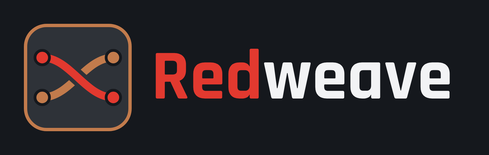
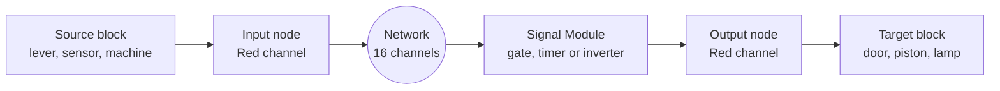
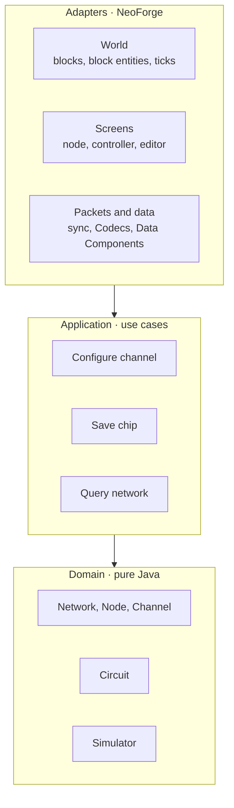

<p align="center"></p>

# Redweave

> Weave your redstone. Wireless signal networks, programmable channels and logic chips — with screens that are easy to learn and beautiful to use.


Redweave is a redstone mod for Minecraft NeoForge. It lets players build complex automation — doors, farms, factories, alarms — out of wireless **nodes**, named **networks**, colored **channels** and reusable **logic chips**, without walls of dust and repeaters.

The goal is not only power, but **experience**: the first useful circuit should take under two minutes and no wiki, every signal should be visible, and every finished build should be something the player is proud to show.

---

## Table of contents

- [Why Redweave](#why-redweave)
- [Core concepts](#core-concepts)
- [Features by phase](#features-by-phase)
- [Items](#items)
- [UX principles](#ux-principles)
- [Architecture](#architecture)
- [Project layout](#project-layout)
- [Building from source](#building-from-source)
- [Real-world bridge (future)](#real-world-bridge-future)
- [Inspirations and credits](#inspirations-and-credits)
- [Contributing](#contributing)
- [License](#license)

---

## Why Redweave

Vanilla redstone is powerful but expensive: a simple AND gate across a base means long wires, chunk boundaries and debugging by trial and error. Existing mods solve parts of this — wireless transmitters, logic gates, integrated circuits, network controllers — but each in its own corner and with its own UI.

Redweave brings those ideas together, focused on **signal only** (items, fluids and energy are left to dedicated logistics mods), with one consistent, friendly interface.

## Core concepts

| Concept | What it is |
| --- | --- |
| **Network** | Created by placing a Network Controller: each controller is one network. Has a name, a color and an owner, who is the only one allowed to change it. Every network shares **16 channels**, colored like wool. A Network Terminal lists all of a player's networks. |
| **Node** | Attaches to any face of any block. Reads or emits redstone there. Joins a network chosen by the player, has a name, and has 16 channel slots, one per channel color, each enabled or disabled. |
| **Channel** | One of the 16 signal lines of a network, each with a wool color and an optional name. Each node slot is tied to one channel and sets its direction (input or output) and block face. Several inputs on one channel → the strongest signal wins. |
| **Signal Module** | A plate that attaches to any face of any block, like a node, and holds signal logic: timer, inverter, gate, counter, memory, latch and more. Source modules, like the Signal Lever, the Signal Button and the Signal Pressure Plate, give a signal of their own, and the Signal Item Sensor reads a container. Its inputs and output are the edges of the plate or network channels. |
| **Signal Cable** | In v0.1.0 (#44): a physical redstone cable that attaches to any face of any block and works like vanilla redstone dust. One item, white at first, dyed in 16 colors; a cable only connects to cables of its own color and owner, so cables of different colors run side by side, and it loses 1 of strength per block, as dust does. |
| **Part** | From v0.1.0 (#44), nodes, modules and cables are parts: up to six share one block space, one per face, with at most two cables. |
| **Chip** | A circuit of gates designed in the Circuit Editor and saved into an item, with a name and icon. It runs as a single high-performance piece. |



## Features by phase

| Phase | Theme | Delivers |
| --- | --- | --- |
| **1 · Wireless** (MVP, v0.1.0) | Signal anywhere | Signal Node, Network Controller, Network Terminal, Configurator tool, Signal Remote, domain simulator, Jade / The One Probe integration |
| **2 · Logic** (v0.1.0) | Logic you can see | Signal Modules: Signal Timer, Signal Inverter, AND / OR / XOR / NAND gate, counter, memory, latch, and source and transformer modules; multipart and the Signal Cable; the Signal Lever (#130), the Signal Button (#131), the Signal Pressure Plate (#132), the Signal Item Sensor (#148), the Signal Lock (#141), the Signal Lamp (#143) and the Signal Alarm (#142), each with a wireless or redstone input or output; planned: the Signal Keypad, Signal Card, block protection and Signal Gate (#144 to #147) |
| **3 · Chips** | Program your redstone | Circuit Workbench, drag-and-drop Circuit Editor with tick-by-tick debug, chips as items, in-game guide book |
| **4 · Expansion** | Integrations | More mod integrations and the port to 26.x |
| **5 · Bridge** (future) | Beyond the game | MQTT bridge to external dashboards and real hardware |

Phases 1 and 2 ship together in v0.1.0, and every release is playable. The work order is in the [roadmap](ROADMAP.md).

## Items

Every item of the mod, delivered or planned. IDs, families and the concept of each item are in the [item catalog](_docs/itens.md), in Portuguese. Every finished item is in the Redweave creative tab, with or without a recipe. Every delivered item is crafted from vanilla materials, and the Signal Modules also take a Signal Node, with at least one redstone in each recipe, and a white Signal Cable takes any of the 15 other dyes; the grids are in the [item catalog](_docs/itens.md#receitas) (#157, #159).

| Item | What it does | Status |
| --- | --- | --- |
| Network Controller | Creates a network when placed, with a name, a color and an owner | Delivered (#14) |
| Network Terminal | Lists your networks and turns them off, on, clears or deletes them | Delivered (#89) |
| Signal Node | Attaches to any face of a block and reads or emits redstone there, in 16 color slots | Delivered (#15) |
| Signal Cable | A physical redstone cable on any face, in 16 colors that keep cables apart | Delivered (#44) |
| Configurator | The tool that opens, turns, copies, toggles and picks up nodes, modules and cables | Delivered (#17, #86, #136) |
| Signal Remote | A tablet linked to a node input that turns its channel on, off or pulses it | Delivered (#22) |
| Signal Lever | A 3D lever its owner turns on and off, with a chosen strength | Delivered (#130) |
| Signal Button | A button its owner presses, which turns off by itself after an on time | Delivered (#131) |
| Signal Pressure Plate | On while players, passive or hostile mobs, or items stand on it | Delivered (#132) |
| Signal Timer | Turns its output on and off at an interval | Delivered (#103) |
| Signal Inverter | The NOT of the mod | Delivered (#105) |
| Weather Detector | On with the chosen weather: rain, thunder or clear | Delivered (#108) |
| Signal Randomizer | Draws its output at each interval | Delivered (#109) |
| Signal Item Sensor | On when the container it sits on holds exactly the chosen amount of an item | Delivered (#148) |
| Signal Lock | Opens only with the exact strength of its key; only its owner removes it, with the Configurator | Delivered (#141) |
| Signal Alarm | A sound, a text and a pulsing red light when it gets a signal, for whom its owner chooses | Delivered (#142) |
| Signal Lamp | An LED bar in the color of its channel, as bright as the signal, with an optional control channel | Delivered (#143) |
| Signal Keypad | A numeric password, kept only on the server, that lets the signal through | Planned (#144) |
| Signal Card | An access card its owner links to locks, keypads and gates | Planned (#145) |
| Signal Gate | A frame whose field only lets through what its rules allow | Planned (#147) |
| Logic modules | Memory, latch, gate, schedule, pulse extender, edge detector, threshold, long delay, player detector and counter | Planned (#110 to #117, #31, #30) |

## UX principles

1. **Always see the signal.** Every node, wire and gate shows whether it is on and how strong (0–15), in the world and on screen.
2. **Simple on the surface, deep underneath.** The common case is one click. Advanced tools (chip editor, tick debugger) exist but stay out of the way.
3. **Configure where you stand.** A new node joins a network with one click, with the last one used already highlighted, and starts with its 16 channels disabled, ready to enable. Shift + scroll changes the Configurator's mode and a gate's mode.
4. **Cheap mistakes.** Undo in the editor, placement preview before a block exists, and clear warnings when a circuit loops or oscillates — pointing to where.
5. **Teach along the way.** Gate tooltips show a small truth table, each screen gives a one-line hint on first use, and the guide book has ready-to-copy examples.

All screens share one grid and one component set (tabs, lists, channel buttons), so learning one screen teaches them all.

## Architecture

Redweave follows **Ports and Adapters** (hexagonal architecture). Everything that decides the value of a signal lives in a pure Java domain and is tested without launching the game.



**Rules**

- Dependencies point inward only. No `net.minecraft` or `net.neoforged` import is allowed in `domain` or `application`; an ArchUnit test enforces it.
- The **Network** aggregate owns its nodes, channels and permissions. The **Circuit** is a graph of gates. The **Simulator** evaluates each network once per tick; in Phase 3, it also compiles that graph in topological order and detects loops and oscillation with the exact location so the UI can show it.
- Adapters translate between the world and the domain, and nothing else.

**Performance**

- Each network is evaluated centrally, once per tick, and only when a channel changed. Nodes never trigger cascading block updates.
- A chip is a single evaluator: a 50-gate circuit costs one piece per tick.
- Target to validate with [spark](https://spark.lucko.me/): a 1,000-node network with no visible MSPT impact.

## Project layout

```text
src/main/java/io/github/marcelofabianov/redweave/
├── RedweaveMod              # entry point: only wires the registries
├── domain/                  # pure Java, no Minecraft imports
│   ├── signal/              # Signal (0–15), ChannelColor
│   ├── network/             # Network aggregate, Node, Channel, permissions
│   ├── circuit/             # AND, OR, XOR and NAND gates and the NOT rule; chips in phase 3
│   ├── module/              # Signal Module rules: connections, the shared interval and the rules of each module
│   ├── part/                # multipart occupancy: one part per face, at most two cables
│   ├── cable/               # Signal Cable runs: which cables join and the strength of each
│   └── simulation/          # tick evaluator, loop and oscillation detection
├── application/             # use cases (one per player action) and their ports
├── config/                  # server config, implements the domain limits
├── registry/                # blocks, items, data components, menus
├── block/ item/ menu/       # world adapters: blocks, block entities, items, menus
│   └── block/part/          # the parts of a block space: node, modules and cable
├── network/                 # packets, validated on the server
├── server/                  # per-server state: networks and use cases
├── compat/                  # Jade and The One Probe, optional (planned)
├── client/                  # screens and renderers
├── datagen/                 # recipes, loot, translations
└── gametest/                # in-world tests

src/test/java/...            # domain and application tests run without the game
```

## Building from source

Requirements: **JDK 21**.

```bash
git clone git@github.com:zenndg/redweave.git
cd redweave

./gradlew test        # domain and application tests
./gradlew runClient   # launch a dev client with the mod
./gradlew build       # jar in build/libs/
```

Built with NeoForge's ModDevGradle for Minecraft 1.21.1. The domain is version-agnostic by design, so a later port to Minecraft 26.x only touches the adapters.

## Real-world bridge (future)

Phase 5 adds a **Bridge Node** that publishes channel changes to an **MQTT** broker and subscribes to commands, so things outside the game become part of a network:

- **External dashboards** — every channel change becomes an event (server, network, channel, value, tick, time) on a topic such as `redweave/<server>/<network>/<channel>`.
- **Linked electrical systems** — an ESP32 with a relay follows a channel; a real sensor publishes into one.
- **Physical toys** — the in-game Signal Remote drives a toy car through an ESP32 and an H-bridge.

The bridge is just another adapter (`EventPublisher` and `CommandReceiver` ports); the core does not change. Safety is a requirement, not an option: disabled by default, server-side only, authenticated broker, rate limits per channel, and a failsafe that stops hardware when commands stop arriving.

## Inspirations and credits

Redweave stands on ideas from great mods. Code from MIT-licensed projects may be studied and reused with its original copyright notice; for the others, only the experience inspired us — no code or textures.

| Mod | What inspired us | License |
| --- | --- | --- |
| [Logistics Network](https://www.curseforge.com/minecraft/mc-mods/logistics-network) | Nodes on any block, channels per node, invisible automation, pack-dev tags | All Rights Reserved (UX only) |
| [XNet](https://www.curseforge.com/minecraft/mc-mods/xnet) | Central controller, performance as a requirement | MIT |
| [Flux Networks](https://www.curseforge.com/minecraft/mc-mods/flux-networks) | Named and colored networks, permissions, remote management | All Rights Reserved (UX only) |
| [RFTools Redstone Transmitter](https://ftb.fandom.com/wiki/Redstone_Transmitter_(RFTools)) | Automatic channel assignment | to be checked |
| [More Red](https://www.curseforge.com/minecraft/mc-mods/more-red) | Plate-shaped gates, placement preview | MIT |
| [Project Red](https://github.com/MrTJP/ProjectRed) | Logic gates, integrated circuits as a single gate, bundled cable | MIT |

## Contributing

Redweave is in development, working toward v0.1.0 (Phases 1 and 2); issues with ideas and feedback are very welcome.

When contributing code:

- **Tests first** for anything in `domain` and `application`.
- Keep the dependency rule: if a class needs Minecraft, it belongs outside `domain` and `application`, in the adapter packages (`block`, `item`, `menu`, `network`, `server`, `client`).
- Small, focused pull requests with a clear description of the player-facing change.

## License

Redweave is licensed under the **[GNU Lesser General Public License v3.0](LICENSE)**. You can use it freely in modpacks; if you distribute a modified version of the mod, its source must be made available under the same license.
