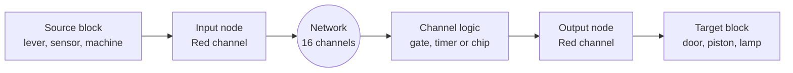
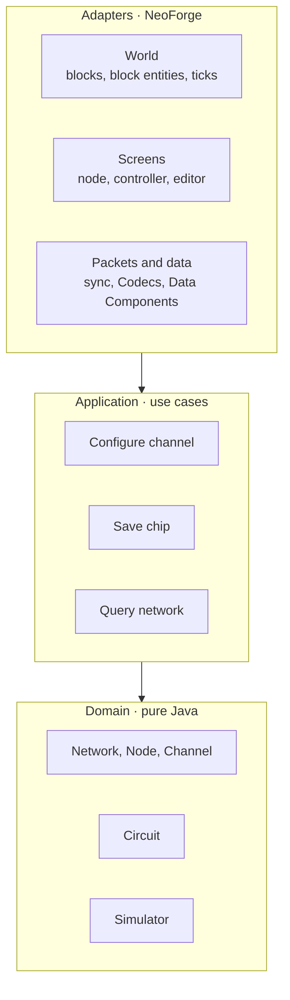

# Redweave

> Weave your redstone. Wireless signal networks, programmable channels and logic chips — with screens that are easy to learn and beautiful to use.


Redweave is a redstone mod for Minecraft NeoForge. It lets players build complex automation — doors, farms, factories, alarms — out of wireless **nodes**, named **networks**, colored **channels** and reusable **logic chips**, without walls of dust and repeaters.

The goal is not only power, but **experience**: the first useful circuit should take under two minutes and no wiki, every signal should be visible, and every finished build should be something the player is proud to show.

---

## Table of contents

- [Why Redweave](#why-redweave)
- [Core concepts](#core-concepts)
- [Features by phase](#features-by-phase)
- [UX principles](#ux-principles)
- [Architecture](#architecture)
- [Project layout](#project-layout)
- [Building from source](#building-from-source)
- [Real-world bridge (future)](#real-world-bridge-future)
- [Inspirations and credits](#inspirations-and-credits)
- [Contributing](#contributing)
- [License](#license)

---

## Why Redweave

Vanilla redstone is powerful but expensive: a simple AND gate across a base means long wires, chunk boundaries and debugging by trial and error. Existing mods solve parts of this — wireless transmitters, logic gates, integrated circuits, network controllers — but each in its own corner and with its own UI.

Redweave brings those ideas together, focused on **signal only** (items, fluids and energy are left to dedicated logistics mods), with one consistent, friendly interface.

## Core concepts

| Concept | What it is |
| --- | --- |
| **Network** | Created at a Network Controller. Has a name, a color, an owner and player permissions. Every network shares **16 channels**, colored like wool. |
| **Node** | Attaches to any face of any block. Reads or emits redstone there. Starts with 4 channel slots (upgradable to 9). Can be made invisible. |
| **Channel** | Per slot: direction (input or output), block face, and which of the 16 network channels it uses. Several inputs on one channel → the strongest signal wins. |
| **Logic** | Each output slot can transform the signal: invert, pulse only, delay, threshold. |
| **Chip** | A circuit of gates designed in the Circuit Editor and saved into an item, with a name and icon. Placed in a node slot, it runs as a single high-performance piece. |



## Features by phase

| Phase | Theme | Delivers |
| --- | --- | --- |
| **1 · Wireless** (MVP) | Signal anywhere | Signal Node, Network Controller, Configurator tool, Remote Control item, domain simulator, Jade / The One Probe integration |
| **2 · Logic** | Gates you can see | Plate-shaped AND / OR / XOR / NOT / NAND gates (floor, wall, ceiling), Timer and Counter, per-channel logic |
| **3 · Chips** | Program your redstone | Circuit Workbench, drag-and-drop Circuit Editor with tick-by-tick debug, chips as items, in-game guide book |
| **4 · Expansion** | Physical wiring | Redstone wire and 16-channel bundled cable, multipart, more mod integrations |
| **5 · Bridge** (future) | Beyond the game | MQTT bridge to external dashboards and real hardware |

Every phase ends with a playable release.

## UX principles

1. **Always see the signal.** Every node, wire and gate shows whether it is on and how strong (0–15), in the world and on screen.
2. **Simple on the surface, deep underneath.** The common case is one click. Advanced tools (chip editor, tick debugger) exist but stay out of the way.
3. **Configure where you stand.** A new node already gets a free channel and works without opening a screen. Pairing is clicking one node on another. Shift + scroll changes a gate's mode.
4. **Cheap mistakes.** Undo in the editor, placement preview before a block exists, and clear warnings when a circuit loops or oscillates — pointing to where.
5. **Teach along the way.** Gate tooltips show a small truth table, each screen gives a one-line hint on first use, and the guide book has ready-to-copy examples.

All screens share one grid and one component set (tabs, lists, channel buttons), so learning one screen teaches them all.

## Architecture

Redweave follows **Ports and Adapters** (hexagonal architecture). Everything that decides the value of a signal lives in a pure Java domain and is tested without launching the game.



**Rules**

- Dependencies point inward only. No `net.minecraft` or `net.neoforged` import is allowed in `domain` or `application`; an ArchUnit test enforces it.
- The **Network** aggregate owns its nodes, channels and permissions. The **Circuit** is a graph of gates. The **Simulator** compiles that graph in topological order, and detects loops and oscillation with the exact location so the UI can show it.
- Adapters translate between the world and the domain, and nothing else.

**Performance**

- Each network is evaluated centrally, once per tick, and only when a channel changed. Nodes never trigger cascading block updates.
- A chip is a single evaluator: a 50-gate circuit costs one piece per tick.
- Target to validate with [spark](https://spark.lucko.me/): a 1,000-node network with no visible MSPT impact.

## Project layout

```text
src/main/java/io/github/marcelofabianov/redweave/
├── domain/                  # pure Java, no Minecraft imports
│   ├── network/             # Network aggregate, Node, Channel, permissions
│   ├── circuit/             # gates, connections, chips
│   └── simulation/          # graph compiler, tick evaluator, loop detection
├── application/             # use cases (one per player action) and ports
│   └── port/                # inbound and outbound interfaces
└── adapter/
    ├── neoforge/            # blocks, block entities, items, menus, screens, packets, codecs
    └── integration/         # Jade, The One Probe, future mod integrations

src/test/java/...            # domain and application tests run without the game
```

## Building from source

Requirements: **JDK 21**.

```bash
git clone https://github.com/marcelofabianov/redweave.git
cd redweave

./gradlew test        # domain and application tests
./gradlew runClient   # launch a dev client with the mod
./gradlew build       # jar in build/libs/
```

Built with NeoForge's ModDevGradle for Minecraft 1.21.1. The domain is version-agnostic by design, so a later port to Minecraft 26.x only touches the adapters.

## Real-world bridge (future)

Phase 5 adds a **Bridge Node** that publishes channel changes to an **MQTT** broker and subscribes to commands, so things outside the game become part of a network:

- **External dashboards** — every channel change becomes an event (server, network, channel, value, tick, time) on a topic such as `redweave/<server>/<network>/<channel>`.
- **Linked electrical systems** — an ESP32 with a relay follows a channel; a real sensor publishes into one.
- **Physical toys** — the in-game Remote Control drives a toy car through an ESP32 and an H-bridge.

The bridge is just another adapter (`EventPublisher` and `CommandReceiver` ports); the core does not change. Safety is a requirement, not an option: disabled by default, server-side only, authenticated broker, rate limits per channel, and a failsafe that stops hardware when commands stop arriving.

## Inspirations and credits

Redweave stands on ideas from great mods. Code from MIT-licensed projects may be studied and reused with its original copyright notice; for the others, only the experience inspired us — no code or textures.

| Mod | What inspired us | License |
| --- | --- | --- |
| [Logistics Network](https://www.curseforge.com/minecraft/mc-mods/logistics-network) | Nodes on any block, channels per node, invisible automation, pack-dev tags | All Rights Reserved (UX only) |
| [XNet](https://www.curseforge.com/minecraft/mc-mods/xnet) | Central controller, performance as a requirement | MIT |
| [Flux Networks](https://www.curseforge.com/minecraft/mc-mods/flux-networks) | Named and colored networks, permissions, live graphs | All Rights Reserved (UX only) |
| [RFTools Redstone Transmitter](https://ftb.fandom.com/wiki/Redstone_Transmitter_(RFTools)) | Zero-config channels, pairing by click | to be checked |
| [More Red](https://www.curseforge.com/minecraft/mc-mods/more-red) | Plate-shaped gates, placement preview | MIT |
| [Project Red](https://github.com/MrTJP/ProjectRed) | Logic gates, integrated circuits as a single gate, bundled cable | MIT |

## Contributing

Redweave is in the design stage; issues with ideas and feedback are very welcome.

When code arrives:

- **Tests first** for anything in `domain` and `application`.
- Keep the dependency rule: if a class needs Minecraft, it belongs in `adapter`.
- Small, focused pull requests with a clear description of the player-facing change.

## License

Redweave is licensed under the **[GNU Lesser General Public License v3.0](LICENSE)**. You can use it freely in modpacks; if you distribute a modified version of the mod, its source must be made available under the same license.
