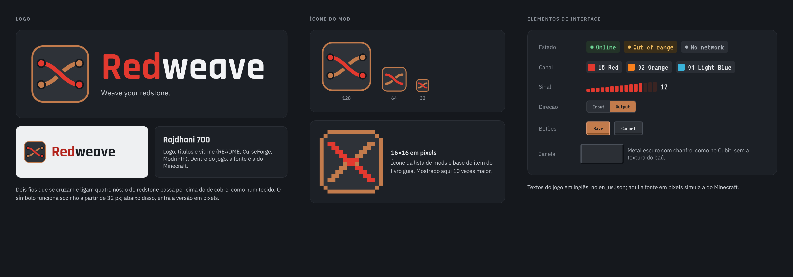
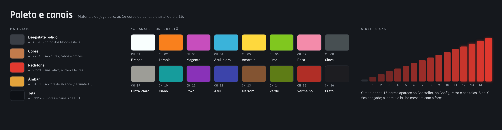
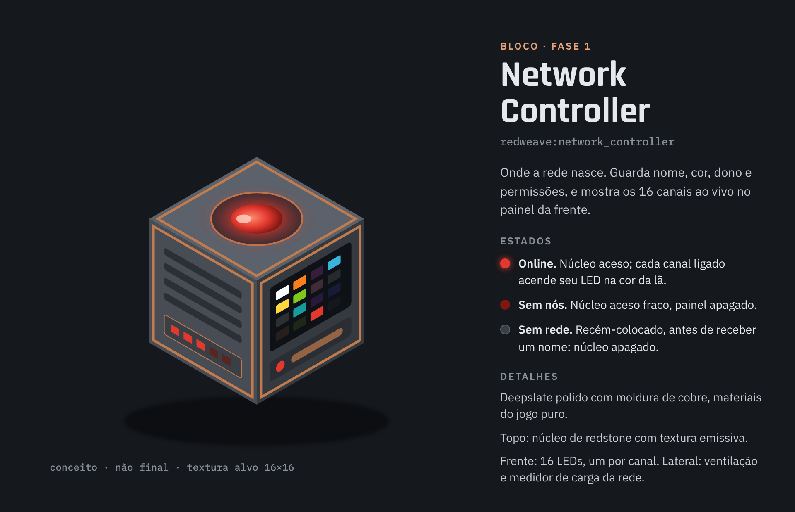
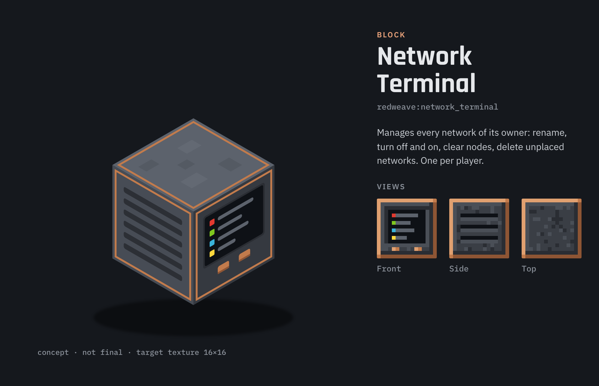
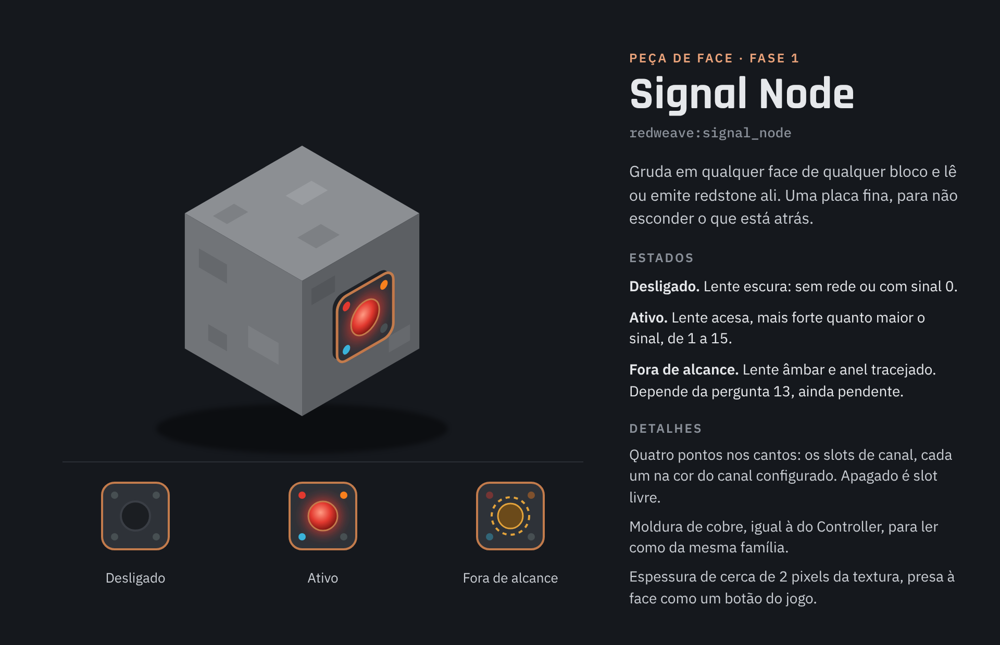
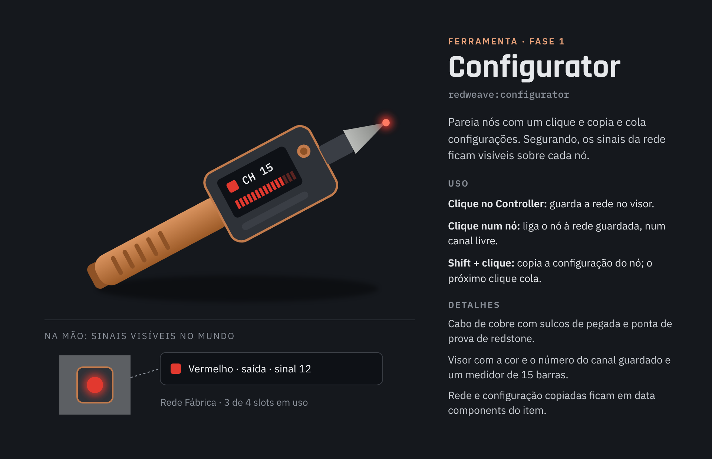

# Visual

A identidade do Redweave e o conceito visual dos blocos, itens e telas. As imagens ficam em [`_docs/imagens/`](../imagens/), em PNG e SVG. Tudo aqui é conceito: as texturas do jogo são de 16×16 e são feitas a partir destas imagens.

## Direção

- **Materiais do jogo puro:** deepslate polido no corpo, cobre nas molduras e redstone no que está ativo. Os blocos e itens parecem da mesma família e combinam com o Iron Meridian.
- **O sinal sempre visível:** o que está ligado acende em vermelho, com brilho, e a força aparece num medidor de 15 barras (pilar 1 de [`ux.md`](ux.md)).
- **Canais pelas cores das lãs:** as 16 cores que o player já conhece no jogo.
- **Telas da família do Cubit:** metal escuro com chanfro, sem a textura do baú, para os dois mods conversarem no mesmo pack.

## Logo

| Versão | Arquivo |
|---|---|
| Logo para fundo escuro | [`logo-escuro.png`](../imagens/identidade/logo-escuro.png) |
| Logo para fundo claro | [`logo-claro.png`](../imagens/identidade/logo-claro.png) |
| Logo em vetor | [`svg/logo.svg`](../imagens/identidade/svg/logo.svg) |
| Símbolo em vetor | [`svg/simbolo.svg`](../imagens/identidade/svg/simbolo.svg) |
| Símbolo em 512 px | [`simbolo-512.png`](../imagens/identidade/simbolo-512.png) |

- **Símbolo:** dois fios que se cruzam e ligam quatro nós. O de redstone passa por cima do de cobre, como num tecido, que é o que o nome diz.
- **Palavra:** **Red** em vermelho e **weave** em branco, ou em grafite no fundo claro, em Rajdhani 700.
- **Lema:** *Weave your redstone.*
- **Uso:** README, páginas do CurseForge e do Modrinth e o livro guia. O `logo.svg` usa a fonte Rajdhani: para uma imagem que não dependa da fonte instalada, use os PNGs.

## Ícone do mod

| Tamanho | Arquivo | Uso |
|---|---|---|
| 128 px | [`icone-128.png`](../imagens/identidade/icone-128.png) | Ícone do projeto no CurseForge e no Modrinth |
| 64 px | [`icone-64.png`](../imagens/identidade/icone-64.png) | Versão sem os nós, para tamanhos médios |
| 32 px | [`icone-32.png`](../imagens/identidade/icone-32.png) | Só os dois fios |
| 16 px | [`icone-16.png`](../imagens/identidade/icone-16.png) ([ampliado](../imagens/identidade/icone-16-ampliado.png)) | Lista de mods do jogo e base do item do livro guia, desenhado pixel a pixel |

O símbolo perde detalhe conforme diminui: os nós somem em 64 px, e em 16 px ele vira um desenho em pixels, não uma redução.

## Tipografia

| Papel | Fonte | Onde |
|---|---|---|
| Logo e títulos | Rajdhani 700 | Logo, README, páginas das plataformas, pranchas de conceito |
| Texto | IBM Plex Sans | Documentos e pranchas |
| Dados | IBM Plex Mono | IDs e números nas pranchas |
| Dentro do jogo | A fonte do Minecraft | Telas, tooltips e textos. Nas pranchas, a VT323 a simula |

## Paleta

| Material | Cor | Uso |
|---|---|---|
| Deepslate polido | `#3A3E45` | Corpo dos blocos e itens |
| Cobre | `#C27B4C` | Molduras, cabos e botões |
| Redstone | `#E2392F` | Sinal ativo, núcleo e lentes |
| Âmbar | `#E3A33B` | Nó `Unloaded`, rede `Unplaced` e modo `Toggle` (perguntas 13, 29, 146 e 241) |
| Tela | `#0E1116` | Visores e painéis de LED |

## Canais

As 16 cores das lãs do jogo, na ordem do jogo. O número é o do canal, de 01 a 16. Nas telas, o nome aparece em inglês.

| Canal | Cor | Nome no jogo | Hex |
|---|---|---|---|
| 01 | Branco | White | `#F9FFFE` |
| 02 | Laranja | Orange | `#F9801D` |
| 03 | Magenta | Magenta | `#C74EBD` |
| 04 | Azul-claro | Light Blue | `#3AB3DA` |
| 05 | Amarelo | Yellow | `#FED83D` |
| 06 | Lima | Lime | `#80C71F` |
| 07 | Rosa | Pink | `#F38BAA` |
| 08 | Cinza | Gray | `#474F52` |
| 09 | Cinza-claro | Light Gray | `#9D9D97` |
| 10 | Ciano | Cyan | `#169C9C` |
| 11 | Roxo | Purple | `#8932B8` |
| 12 | Azul | Blue | `#3C44AA` |
| 13 | Marrom | Brown | `#835432` |
| 14 | Verde | Green | `#5E7C16` |
| 15 | Vermelho | Red | `#B02E26` |
| 16 | Preto | Black | `#1D1D21` |

O canal 15 usa o vermelho da lã. O vermelho de redstone, `#E2392F`, fica para o brilho do sinal, para os dois não se confundirem.

## Sinal

O sinal vai de 0 a 15 (regra 5 do `AGENTS.md`) e aparece como um medidor de 15 barras, que crescem em altura e intensidade. Sinal 0 fica apagado. A partir de 12, as barras brilham. O medidor aparece na Tela do Nó, no painel do canal escolhido (pergunta 346). O visor do Configurator mostra só a cor do modo (pergunta 271).

## Elementos de interface

| Elemento | Como é |
|---|---|
| Estado | Etiqueta com ponto colorido: `Online` em verde, `Unloaded` em âmbar, `Out of range` em vermelho, `No network` em cinza, `Offline` em cinza e `Unplaced` em âmbar, no Terminal (perguntas 29, 146 e 177) |
| Canal | Quadrado na cor do canal, com o número e o nome em inglês, como `15 Red` |
| Sinal | O medidor de 15 barras e o número |
| Direção | Seletor de duas opções, `Input` e `Output`, com a escolhida em cobre |
| Botões | Principal em cobre, secundário em metal escuro, os dois com sombra interna embaixo |
| Janela | Metal escuro com chanfro claro em cima e à esquerda e escuro embaixo e à direita, como no Cubit |
| Abas | Na Tela do Controlador, uma fileira horizontal sob o cabeçalho, como estado só do cliente; a Tela do Nó não tem abas laterais (pergunta 233) |

## Blocos e itens da Fase 1

Os quatro elementos da primeira interação e o Network Terminal, que entrou depois (pergunta 130) e ganhou a prancha na #89. Cada prancha tem a ilustração, os estados e os detalhes, e a ilustração também está em SVG, em [`conceito/svg/`](../imagens/conceito/svg/).

### Network Controller

Bloco, `redweave:network_controller`. Onde a rede nasce: guarda nome, cor, dono e permissões e mostra os 16 canais ao vivo.

| Parte | Como é |
|---|---|
| Corpo | Deepslate polido, com moldura de cobre em todas as faces |
| Topo | Núcleo de redstone com textura emissiva |
| Frente | Painel com 16 LEDs, um por canal, na cor da lã |
| Lateral | Grelha de ventilação e medidor de carga da rede |

| Estado | Visual |
|---|---|
| Online | Núcleo aceso (`linked`). Os LEDs por canal e o brilho do topo chegam com a #24 |
| Offline ou sem rede | Núcleo apagado: rede desligada no Terminal, ou controlador sem rede, como quando o save se perde (perguntas 53, 57, 177 e 319) |

### Network Terminal

Bloco, `redweave:network_terminal`. Administra todas as redes do dono, de onde ele as renomeia, desliga, religa, limpa e abre (pergunta 131). A prancha veio da #89 (perguntas 185, 186 e 251), e as texturas usam na moldura o mesmo cobre do Network Controller (pergunta 258).

| Parte | Como é |
|---|---|
| Corpo | Deepslate polido, com moldura de cobre em todas as faces, como o Network Controller |
| Frente | Visor escuro (`#0E1116`) com linhas curtas coloridas, uma por rede, como uma lista. A frente vira para o player ao colocar |
| Lateral | A grelha de ventilação do controlador |
| Topo e base | Deepslate com moldura de cobre, sem núcleo |

| Estado | Visual |
|---|---|
| Único | O Terminal não tem estado próprio. A camada emissiva do visor chega com a #24, como no controlador |

### Signal Node

Peça de face, `redweave:signal_node`. Gruda em qualquer face de qualquer bloco e lê ou emite redstone ali.

| Parte | Como é |
|---|---|
| Placa | Fina, com cerca de 2 pixels de espessura, presa à face como um botão do jogo, com moldura de cobre |
| Lente | No centro, acende na cor do sinal |
| Slots | Quatro pontos nos cantos, com os 4 primeiros canais ativos, na ordem das cores; sem canal ativo, os quatro ficam escuros (perguntas 224 e 229) |

| Estado | Visual |
|---|---|
| Desligado | Lente escura: sem rede, rede `Offline` ou `Unplaced`, ou sinal 0 (perguntas 135 e 177) |
| Ativo | Lente acesa, mais forte quanto maior o sinal |
| Fora de alcance | Lente apagada e anel tracejado vermelho: o nó está fora do raio do controlador e não conta (perguntas 23 e 29). O nó `Unloaded` não aparece no mundo, porque o chunk dele não está carregado |

### Configurator

Ferramenta, `redweave:configurator`. Abre, copia, cola, ativa e desativa canais e retira Signal Nodes, com quatro modos ([`configurador.md`](../funcionalidades/configurador.md)). A prancha é anterior às perguntas 126 a 169 e mostra o visor do canal guardado, que deu lugar ao visor do modo.

| Parte | Como é |
|---|---|
| Cabo | Cobre, com sulcos de pegada |
| Visor | Visor de 3×2 pixels: os 2×2 da esquerda na cor do modo, e o pixel de cima da direita aceso quando há cópia (pergunta 271) |
| Ponta | Ponta de prova com redstone na extremidade |
| Na mão | Um rótulo flutuante sobre cada nó, em duas linhas: em cima, menor, `■ rede` na cor dela; embaixo, um pouco maior, o nome do nó (perguntas 268 e 274 a 276) |

| Modo | Em português | Cor | Tom | Uso |
|---|---|---|---|---|
| `Open` | `Abrir` | Azul | `#5B9BF0` | Clique num nó abre a Tela do Nó; no controlador e no Terminal, abre a tela do bloco, como a mão vazia |
| `Copy` | `Copiar` | Verde | `#3FAE5A` | Clique num nó copia; Shift + clique cola |
| `Toggle` | `Alternar` | Âmbar | `#E3A33B` | Clique num nó ativa os canais configurados; Shift + clique desativa (pergunta 241) |
| `Wrench` | `Chave` | Vermelho | `#D94A64` | Clique num nó o retira como item |

A cor do modo aparece com o nome escrito na action bar e no tooltip, e sozinha no visor, que é pequeno demais para texto (pergunta 271), para não ser confundida com as cores dos canais, com o `Online` (`#6BD48F`) ou com o vermelho de redstone (`#E2392F`), nem depender só da cor para quem tem daltonismo. O rótulo flutuante sobre os nós não usa a cor do modo (perguntas 167 a 169).

O modo e a configuração copiada ficam em data components do item (regra 7 do `AGENTS.md`).

### Signal Remote

Item, `redweave:signal_remote`, com aparência de tablet (pergunta 279). Shift + clique direito abre a lista de redes, depois a de nós com slot de input ativo e, se houver mais de um, a de slots (perguntas 282 e 286); o clique direito dispara. Modos alavanca e botão, num seletor na tela do vínculo (pergunta 288). Guarda rede, nó e slot; se o vínculo quebra, mostra `Link lost` e não dispara (pergunta 287). Shift + clique direito troca o vínculo a qualquer momento (pergunta 291). O visual do tablet é decidido no refinamento da #22, e a prancha [`signal-remote.png`](../imagens/conceito/signal-remote.png) e as texturas `signal_remote_*` são do conceito antigo, a alavanca de bolso.

## Histórico de modificações

| Pessoa | Data e hora | Modificação |
|---|---|---|
| Zennd | 2026-11-12 19:51 | O medidor da Tela do Nó vai para o painel do canal (pergunta 346). |
| Zennd | 2026-11-12 19:23 | O modo `Open` abre também as telas do controlador e do Terminal (perguntas 232 e 343). |
| Zennd | 2026-11-12 17:27 | Alinha os estados do controlador ao código (perguntas 177 e 319). |
| Zennd | 2026-11-12 17:18 | Atualiza o medidor, os estados `Offline` e `Unplaced`, as abas, os cantos do nó, o Configurator e o Signal Remote em tablet (perguntas 135, 146, 177, 224, 229, 233, 241, 271, 279 e 282 a 291). |
| Zennd | 2026-11-12 11:46 | O rótulo sobre os nós em duas linhas (perguntas 274 a 276). |
| Zennd | 2026-11-12 11:11 | Aplica o visor só com a cor, o rótulo sobre os nós e o modo `Toggle` (perguntas 241 e 267 a 271). |
| Zennd | 2026-11-12 09:49 | Adiciona o conceito e a prancha do Network Terminal (perguntas 251 e 258). |
| Zennd | 2026-11-11 09:51 | Troca as ações do Configurator pelos modos, com as cores e os tons (perguntas 143 e 159 a 169). |
| Marcelo Fabiano | 2026-11-10 09:05 | Corrige o estado Sem rede do Network Controller. |
| Marcelo Fabiano | 2026-11-09 15:39 | Separa os estados `Unloaded` e `Out of range` (pergunta 29). |
| Marcelo Fabiano | 2026-11-09 11:03 | Aplica as respostas das perguntas 13 e 15. |
| Marcelo Fabiano | 2026-11-09 11:15 | Adiciona o conceito dos blocos e itens da Fase 1. |
| Marcelo Fabiano | 2026-11-09 11:10 | Adiciona a identidade visual, a paleta, os canais e os elementos de interface. |
