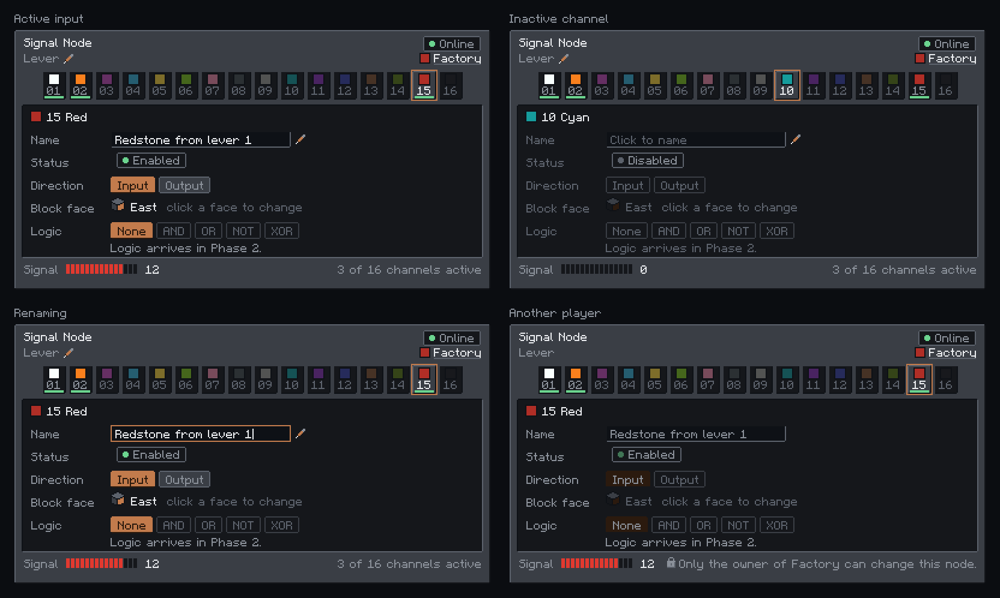
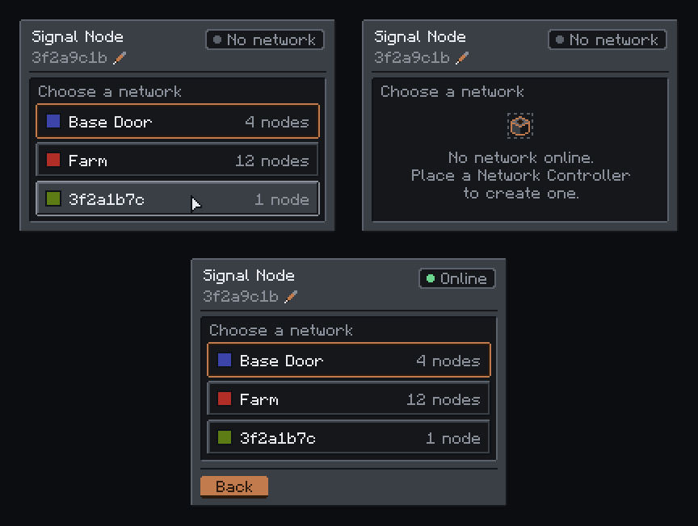
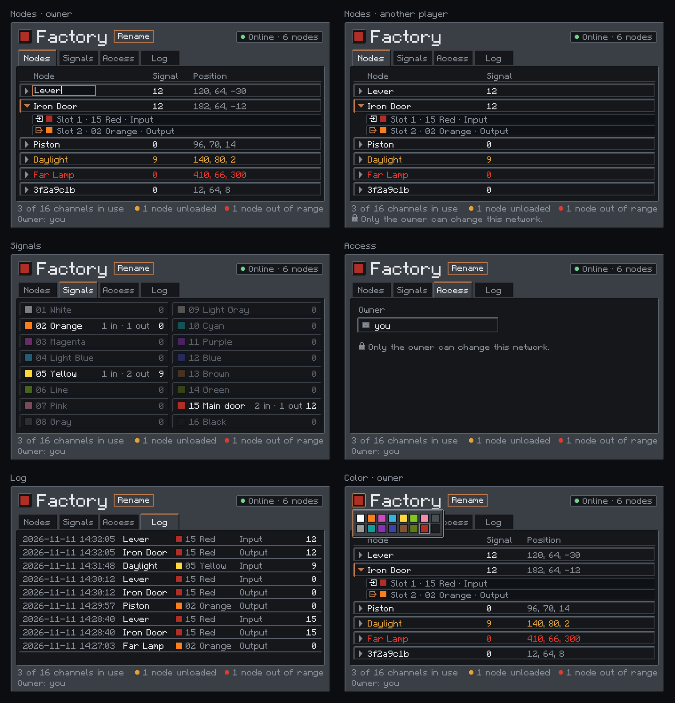

# Telas

As telas próprias do Redweave na Fase 1: a do Signal Node e a do Network Controller. A do Network Terminal está em [`terminal-de-rede.md`](terminal-de-rede.md). Elas seguem os pilares de [`ux.md`](../conceito/ux.md) e os elementos de interface de [`visual.md`](../conceito/visual.md#elementos-de-interface). Este documento é o conceito das telas; o comportamento da rede fica na página da rede e dos canais (issue #7).

## Princípios

- **Estilo:** janelas próprias de metal escuro com chanfro, sem a textura do baú do jogo, na mesma linha das telas do Cubit.
- **Textos:** em inglês, no `en_us.json`, e em português, no `pt_br.json`, com as mesmas chaves (regra 1 do `AGENTS.md`). As imagens mostram os textos em inglês.
- **Nada passa da borda:** texto longo é cortado com reticências, e um tooltip mostra o texto inteiro.
- **Sinal ao vivo:** valores e medidores atualizam com a tela aberta, pelo servidor (regra 16).
- **Quem abre:** qualquer player. Só o dono da rede altera alguma coisa, validado no servidor (regra 17 e pergunta 22). Para os outros, a tela abre só para leitura.
- **Rede `Offline`:** as telas da rede não abrem, nem para o dono, e a action bar mostra `<rede> is offline. Turn it on at a Network Terminal.` Só o Network Terminal age sobre ela (perguntas 132 e 160).
- **Escala:** as imagens mostram as telas em 2×. Os tamanhos finais em pixels da interface do jogo são definidos na implementação.

## Tela do Nó

**Abre** com um clique no Signal Node com o [Configurator](configurador.md) no modo `Open` (pergunta 140). A mão vazia só mostra a dica `Use a Configurator to open this node.` (pergunta 154).

### Escolha de rede

Um nó `No network` abre na escolha de rede, e não na configuração (pergunta 139). Desenho: [`tela-do-no-escolha-de-rede.png`](../imagens/telas/tela-do-no-escolha-de-rede.png), com os sprites de [`tela-do-no-sprites-c.png`](../imagens/telas/tela-do-no-sprites-c.png) (pergunta 198).

| Ponto | Como é | Pergunta |
|---|---|---|
| Quem escolhe | Só quem colocou o nó. Para os outros, a tela abre só para leitura, com `No network` | 172 |
| Lista | As redes `Online` de quem colocou o nó, com a última em que ele colocou um nó destacada | 157 |
| Escolher | Um clique numa rede liga o nó a ela, com 1 slot `Input` no primeiro canal livre, e a tela segue para a configuração | 171 |
| Linha | O quadrado na cor da rede, o nome e a quantidade de nós, como `1 node` e `12 nodes`. A última usada fica no topo, em cobre, e as outras seguem em ordem alfabética, sem diferenciar maiúsculas | 202 e 203 |
| Sem redes | A lista vazia, com o ícone do controlador e `No network online. Place a Network Controller to create one.` | 199 |
| Trocar depois | Na configuração, o clique no nome da rede volta a esta lista, para trocar de rede ou voltar mantendo a atual. É preciso ser dono das duas redes | 141 |
| Voltar | Na troca, o botão `Back` no rodapé volta à configuração sem mudar nada. Não aparece na primeira escolha | 205 |
| No servidor | A tela recebe só as linhas, e o clique manda a posição na lista que o servidor guardou, nunca o ID da rede. O servidor confere de novo quem pode escolher | 172 e regra 17 |

### Configuração

| Parte | O que mostra |
|---|---|
| Título | `Signal Node` |
| Nome do nó | Abaixo do título, o nome, que nasce com os 8 primeiros caracteres do ID. Para o dono, vem com um lápis, e o clique o troca por um campo de texto: Enter salva, Esc cancela, e vazio volta ao padrão. O texto vai num pacote próprio, e o servidor confere o dono, o alcance e o limite de `node.name_length` (perguntas 142, 144 e 204) |
| Rede | Na linha do nome, à direita, o quadrado na cor da rede e o nome dela, em qualquer estado com rede. Para o dono, o clique abre a escolha de rede (perguntas 141 e 208) |
| Estado | No canto superior direito: `Online`, `Unloaded`, `Out of range`, `No network` ou `Offline`, em cinza ([estados do nó](rede-e-canais.md#estados-do-nó)) (perguntas 177 e 208) |
| Slots | À esquerda, um botão por slot de canal: a cor e o nome do canal, a direção e o sinal, como `15 Red` e `Output · signal 12`. Um canal renomeado na Tela do Controlador aparece com o nome dado, como `15 Main door` (pergunta 221). Slot livre aparece tracejado, com `Free slot` e `Click to use` |
| Slot escolhido | À direita, a configuração do slot selecionado |
| Direção | Seletor `Input` e `Output` |
| Face do bloco | Um cubo com a face escolhida em cobre, o nome da face, como `East`, e `click a face to change` |
| Canal | As 16 cores, em duas fileiras de 8, com a escolhida destacada, e o nome do canal |
| Lógica | `None`, `Invert`, `Pulse`, `Delay` e `Threshold`. Na Fase 1, só `None` fica habilitada, com o aviso `Logic arrives in Phase 2. Until then, Output repeats the channel as it is.` |
| Rodapé | O medidor de 15 barras com o sinal do slot e quantos slots estão em uso, como `3 of 4 slots in use` |
| Abas | À direita: `Slots`, `Upgrades` e `Info` |

A quantidade de slots vem de [`limites.md`](../limites.md), nunca fixa na tela (regra 3). O conteúdo das abas `Upgrades` e `Info` é definido junto com os upgrades.

### Comportamento

O que a tela faz, decidido na issue #19.

| Ponto | Como é | Pergunta |
|---|---|---|
| Desenho | Sprites em pixel art, em 9-slice como os do jogo, das folhas [`tela-do-no-sprites-a.png`](../imagens/telas/tela-do-no-sprites-a.png) e [`tela-do-no-sprites-b.png`](../imagens/telas/tela-do-no-sprites-b.png). Os textos usam a fonte do jogo | 78 |
| Abas | Por enquanto, só `Slots`. `Upgrades` e `Info` entram quando tiverem conteúdo | 80 |
| Selecionar um slot | Um clique no slot da lista o mostra à direita. A seleção é só do cliente | — |
| Usar um slot livre | `Click to use` cria uma entrada na face onde o nó está grudado, no primeiro canal livre, e seleciona o slot | 83 |
| Direção | Um clique em `Input` ou `Output` troca a direção do slot | — |
| Face do bloco | Um cubo 3D com o próprio bloco de apoio, girável arrastando o mouse. A face sob o cursor e a escolhida ficam realçadas em cobre, e o clique escolhe a face | 79 |
| Canal | Um clique numa das 16 cores troca o canal do slot | — |
| Liberar um slot | O botão `Clear slot` pede confirmação no segundo clique, `Click again to clear` | 84 |
| Medidor | O sinal do slot escolhido: na entrada, a última leitura; na saída, o que ela emite | — |
| Ao vivo | O estado, a rede, os nomes, a lista de escolha e o sinal de cada slot atualizam a cada tick, só quando mudam | 82 |
| Só leitura | Para quem não é o dono, os controles ficam apagados, e o rodapé mostra um cadeado e `Only the owner of <rede> can change this node.` | 85 |

**O servidor confere cada ação (regras 16 e 17):** quem pede é o dono da rede do nó, o player está dentro do alcance de interação de blocos do jogo (pergunta 81), o slot existe e a face e o canal são válidos. Uma ação recusada não muda nada, e a tela volta a mostrar o estado do servidor.

## Tela do Controlador

**Abre** com um clique no Network Controller com a mão vazia, ou pela lista do [Network Terminal](terminal-de-rede.md) (perguntas 113 e 131). O desenho tem seis variantes, com a aba `Log` da #90 (pergunta 214), e os sprites estão em [`tela-do-controlador-sprites.png`](../imagens/telas/tela-do-controlador-sprites.png).

| Parte | O que mostra |
|---|---|
| Cabeçalho | O quadrado na cor da rede e o nome dela. Para o dono, o clique no quadrado abre a paleta, e o botão `Rename` troca o nome por um campo de texto (perguntas 156 e 212) |
| Estado | `Online · <n> nodes` |
| Abas | `Nodes`, `Signals` e `Access`. A aba `Log` entra com a #90 (pergunta 215) |
| Nodes | Uma linha por nó, na ordem em que entraram na rede, com o nome, o sinal de 0 a 15 e a posição x, y e z do bloco do nó (perguntas 179 e 216). O sinal é o da lente, o mais forte entre as leituras e a emissão, e 0 num nó que não conta (pergunta 98). A posição só aparece para o dono (pergunta 149). Um nó `Unloaded` aparece em âmbar, e um `Out of range`, em vermelho (pergunta 29). Um Signal Remote aparecerá com a posição `held item`, quando o Remote existir |
| Log | Entra com a #90: uma linha por mudança de valor de uma entrada ou de uma saída, com a data e a hora reais do servidor, o nome do nó, o canal, a direção e o valor. Guarda as últimas `log.size` linhas da rede, só em memória, e chega só a quem está com a tela aberta (perguntas 147 e 148) |
| Rodapé | Na primeira linha, os canais em uso, como `3 of 16 channels in use`, e quantos nós estão `Unloaded`, em âmbar, e `Out of range`, em vermelho, mesmo com zero (pergunta 219). Na segunda, `Owner: <dono>` ou, para os outros, o cadeado e `Only the owner can change this network.` |

O log substitui o gráfico dos últimos 30 segundos (pergunta 150). O conteúdo das abas `Signals` e `Access` está em [`rede-e-canais.md`](rede-e-canais.md#abas-da-tela-do-controlador). Um nó `Unloaded` continua contando para o canal com o último valor lido, e um `Out of range` não conta (perguntas 13, 23 e 29).

### Comportamento

O que a tela faz, decidido na issue #20.

| Ponto | Como é | Pergunta |
|---|---|---|
| Quem abre | Qualquer player, com a mão vazia. Para quem não é o dono, a tela é só leitura: sem `Rename`, sem paleta e sem renomear nós e canais | 22 |
| Rede `Offline` | Nada abre, e a action bar mostra o aviso. Uma tela aberta fecha se a rede for desligada | 158 e 160 |
| Linha aberta | O clique numa linha mostra os slots em uso abaixo dela, com o ícone de entrada ou de saída, a cor, o canal e a direção, como `Slot 1 · 15 Red · Input`. Abrir uma linha fecha a anterior | 179 e 218 |
| Renomear um nó | Para o dono, o duplo clique no nome vira um campo de texto: Enter salva, Esc cancela, e vazio volta ao padrão. Um clique, no nome ou no resto da linha, abre e fecha os slots, e o duplo clique deixa a linha como estava | 144, 217 e 222 |
| Renomear a rede | O botão `Rename` troca o nome por um campo de texto. Um nome vazio é recusado, e o nome continua o mesmo | 156 |
| Renomear um canal | Na aba `Signals`, o duplo clique no nome vira um campo de texto, e vazio volta ao nome da cor | 26, 34 e 222 |
| Trocar a cor | A paleta abre sob o quadrado da cor, com as 16 cores em duas fileiras de 8 e a atual destacada. O clique numa cor a escolhe e fecha a paleta | 212 |
| Lista vazia | A aba `Nodes` de uma rede sem nós mostra `No node in this network yet.` no meio da tabela | 220 |
| Rolagem | A roda do mouse rola a lista de nós quando ela não cabe | — |
| Ao vivo | Os nomes e as linhas vão ao cliente só quando mudam, e os sinais e os estados vão à parte, também só quando mudam, para um circuito rápido não reenviar a lista inteira (regra 18) | 82 |

**O servidor confere cada ação (regras 16 e 17):** a ação só chega da tela aberta daquele controlador, ao alcance de interação de blocos do jogo e com a rede `Online`, e o domínio confere o dono e o tamanho do nome. O cliente aponta um nó pela posição dele na lista que o servidor guardou, nunca pelo ID, e a posição dos nós nem sai do servidor para quem não é o dono.

## Pendências

| Ponto | Depende de |
|---|---|
| Conteúdo das abas `Upgrades` e `Info`, que por enquanto não aparecem (pergunta 80) | Issue dos upgrades |

## Histórico de modificações

| Pessoa | Data e hora | Modificação |
|---|---|---|
| Zennd | 2026-11-11 15:47 | Aplica a pergunta 222: nós e canais são renomeados com duplo clique. |
| Zennd | 2026-11-11 15:40 | Descreve a Tela do Controlador entregue na #20, com a imagem nova e as perguntas 212 a 221. |
| Zennd | 2026-11-11 14:09 | Adiciona o estado `Offline` na pílula da Tela do Nó, da #88. |
| Zennd | 2026-11-11 13:46 | Descreve a escolha de rede, o nome do nó e o link da rede entregues na #87 (perguntas 198 a 208). |
| Zennd | 2026-11-11 10:24 | Aplica a pergunta 179. |
| Zennd | 2026-11-11 09:51 | Aplica a abertura pelo Configurator, a escolha de rede, o nome do nó, a lista de nós e o log no lugar do gráfico (perguntas 139 a 160). |
| Marcelo Fabiano | 2026-11-10 11:26 | Descreve o comportamento da Tela do Nó com as perguntas 78 a 85. |
| Marcelo Fabiano | 2026-11-09 15:39 | Aplica as perguntas 22 e 29 e aponta as abas `Signals` e `Access` para a página da rede. |
| Marcelo Fabiano | 2026-11-09 11:03 | Aplica as respostas das perguntas 13 e 15. |
| Marcelo Fabiano | 2026-11-09 11:20 | Descreve as telas do nó e do controlador. |
