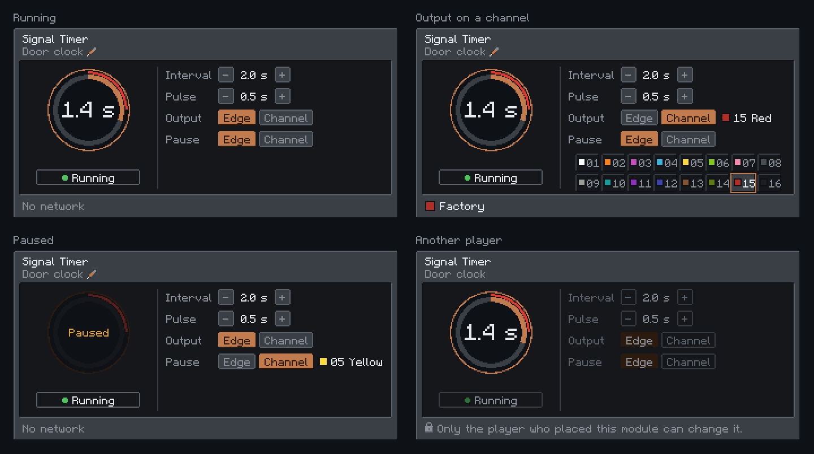
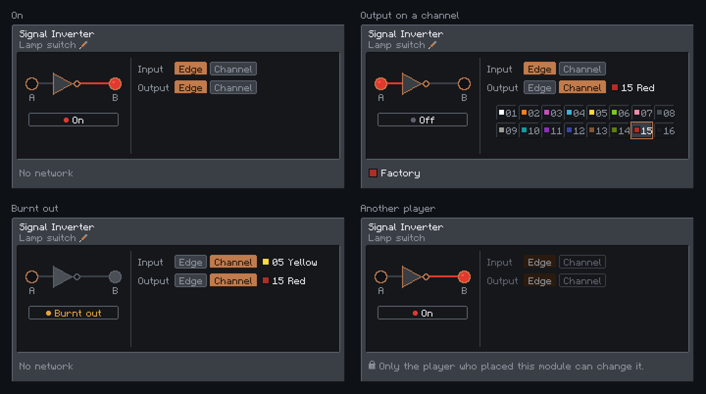
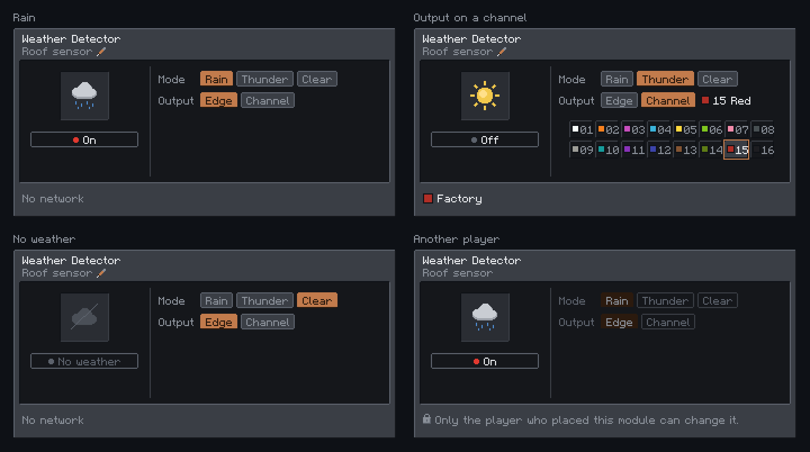
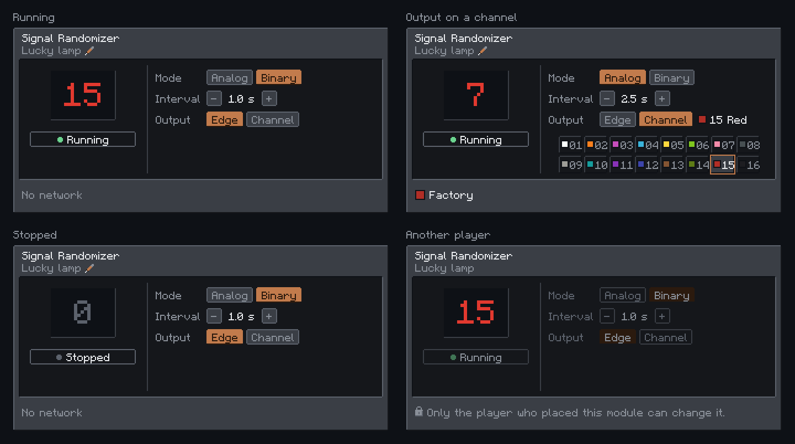

# Telas

As telas próprias do Redweave: a do Signal Node, a do Network Controller, a do vínculo do Signal Remote e as dos Signal Modules: Signal Timer, Signal Inverter, Weather Detector, Signal Randomizer, Signal Lever, Signal Button, Signal Pressure Plate, Signal Item Sensor, Signal Lock, Signal Lamp e Signal Alarm. A do Network Terminal está em [`terminal-de-rede.md`](terminal-de-rede.md). Elas seguem os pilares de [`ux.md`](../conceito/ux.md) e os elementos de interface de [`visual.md`](../conceito/visual.md#elementos-de-interface). Este documento é o conceito das telas; o comportamento da rede fica na página da rede e dos canais (issue #7).

## Princípios

- **Estilo:** janelas próprias de metal escuro com chanfro, sem a textura do baú do jogo, na mesma linha das telas do Cubit.
- **Textos:** em inglês, no `en_us.json`, e em português, no `pt_br.json`, com as mesmas chaves (regra 1 do `AGENTS.md`). As imagens mostram os textos em inglês.
- **Nada passa da borda:** texto longo é cortado com reticências, e um tooltip mostra o texto inteiro.
- **Sinal ao vivo:** valores e medidores atualizam com a tela aberta, pelo servidor (regra 16).
- **Quem abre:** qualquer player. Só o dono da rede altera alguma coisa, validado no servidor (regra 17 e pergunta 22), e, num Signal Module, só o dono da placa (pergunta 378). Para os outros, a tela abre só para leitura.
- **Rede `Offline`:** as telas da rede não abrem, nem para o dono, e a action bar mostra `<rede> is offline. Turn it on at a Network Terminal.` Só o Network Terminal age sobre ela (perguntas 132 e 160).
- **Escala:** as imagens mostram as telas em 2×. Os tamanhos finais em pixels da interface do jogo são definidos na implementação.

## Tela do Nó

**Abre** com um clique no Signal Node com o [Configurator](configurador.md) no modo `Open` (pergunta 140). A mão vazia só mostra a dica `Use a Configurator to open this node.` (pergunta 154).

### Escolha de rede

Um nó `No network` abre na escolha de rede, e não na configuração (pergunta 139). Desenho: [`tela-do-no-escolha-de-rede.png`](../imagens/telas/tela-do-no-escolha-de-rede.png), com os sprites de [`tela-do-no-sprites-c.png`](../imagens/telas/tela-do-no-sprites-c.png) (pergunta 198).

| Ponto | Como é | Pergunta |
|---|---|---|
| Quem escolhe | Só quem colocou o nó. Para os outros, a tela abre só para leitura, com `No network` | 172 |
| Lista | As redes `Online` de quem colocou o nó, com a última em que ele colocou um nó destacada | 157 |
| Escolher | Um clique numa rede liga o nó a ela, com os 16 canais inativos, e a tela segue para a configuração | 171 e 226 |
| Linha | O quadrado na cor da rede, o nome e a quantidade de componentes, como `1 component` e `12 components` (pergunta 804). A última usada fica no topo, em cobre, e as outras seguem em ordem alfabética, sem diferenciar maiúsculas | 202 e 203 |
| Rolagem | A lista, de 110 px desde a #177, mostra 3 redes por vez e rola com a roda do mouse quando há mais | 333, 348 e 872 |
| Sem redes | A lista vazia, com o ícone do controlador e `No network online. Place a Network Controller to create one.` | 199 |
| Trocar depois | Na configuração, o clique no nome da rede volta a esta lista, para trocar de rede ou voltar mantendo a atual. É preciso ser dono das duas redes | 141 |
| Voltar | Na troca, o botão `Back` no rodapé volta à configuração sem mudar nada. Não aparece na primeira escolha | 205 |
| No servidor | A tela recebe só as linhas, e o clique manda a posição na lista que o servidor guardou, nunca o ID da rede. O servidor confere de novo quem pode escolher | 172 e regra 17 |

### Configuração

| Parte | O que mostra |
|---|---|
| Título | `Signal Node` |
| Nome do nó | Abaixo do título, o nome, que nasce com os 8 primeiros caracteres do ID. Para o dono, vem com um lápis, e o clique o troca por um campo de texto: Enter salva, Esc cancela, e vazio volta ao padrão. O texto vai num pacote próprio, e o servidor confere o dono, o alcance e o limite de `node.name_length` (perguntas 142, 144 e 204) |
| Rede | Na linha do nome, à direita, o quadrado na cor da rede e o nome dela, em qualquer estado com rede. Para o dono, o clique abre a escolha de rede (perguntas 141 e 208) |
| Estado | No canto superior direito: `Online`, `Unloaded`, `Out of range`, `No network` ou `Offline`, em cinza ([estados do nó](rede-e-canais.md#estados-do-nó)) (perguntas 177 e 208) |
| Canais | Abaixo do nome, uma fileira com os 16 canais, cada um com a cor e o número, de `01` a `16`. Os ativos têm uma barra verde embaixo, e o escolhido tem o contorno de cobre (perguntas 224 e 231) |
| Canal escolhido | Abaixo da fileira, o painel do canal, em duas colunas: à esquerda, o título, o `Status`, a direção e o sinal; à direita, a face do bloco (pergunta 346). O título é como `15`, ao lado do quadrado na cor do canal, ou `15 Main door` com o canal renomeado na Tela do Controlador (perguntas 221 e 770) |
| Status | A pílula `On`, verde, ou `Off`, cinza, e `Ligado` ou `Desligado` em português. O clique troca o status (perguntas 226, 228 e 774) |
| Direção | Seletor `Input` e `Output`. Só muda com o canal `Off`; com `On`, fica travado (perguntas 237 e 774) |
| Sinal | Na coluna da esquerda, o medidor de 15 barras com o sinal do canal escolhido e o número; um canal inativo mostra 0 (pergunta 346) |
| Face do bloco | Na coluna da direita, separada por uma linha, um cubo de 40 px com a face escolhida em cobre e, ao lado, só o nome da face, como `East`, na altura do meio do cubo (pergunta 372), e, no hover do cubo, o tooltip `Click a face to choose it. Drag to turn the block.`. Só muda com o canal `Disabled`; um canal nunca ativado parte da face grudada (pergunta 237) |
| Delay | Entre o painel do canal e o rodapé, fora do painel, porque é do nó inteiro e não do canal aberto: `Delay`, o valor, como `3 s`, e os botões `−` e `+`, de 1 s por clique, de 0 a 15 s. Aparece sempre, mesmo sem slot `Output`; só o dono da rede clica, e para os outros os botões ficam apagados. `Atraso` em português, com a mesma chave das telas de módulo ([delay na saída do nó](no-de-sinal.md#delay-na-saída), perguntas 861, 866 e 870) |
| Rodapé | Uma linha: à esquerda, quantos canais estão ativos, como `3 of 16 channels active`; à direita, só para quem não é o dono, o cadeado (pergunta 347) |

A tela não tem abas laterais. A aba `Info` volta quando tiver conteúdo (pergunta 233). O painel do canal também não tem lógica: o nó só lê e emite, e toda lógica de sinal fica nos Signal Modules (pergunta 308); o delay na saída é tempo, não lógica (pergunta 859). O painel tem 76 px de altura, a linha `Delay` 14 px, o rodapé 20 px e a tela 186 px desde a #177, a mesma altura das telas de módulo, sem arte nova, porque a moldura é desenhada com os sprites que já existem; a escolha de rede usa a mesma altura, com a lista de 110 px (perguntas 329, 330, 333, 348, 866 e 872).

### Comportamento

O que a tela faz, decidido na issue #19.

| Ponto | Como é | Pergunta |
|---|---|---|
| Desenho | Sprites em pixel art, em 9-slice como os do jogo, das folhas [`tela-do-no-sprites-a.png`](../imagens/telas/tela-do-no-sprites-a.png), [`tela-do-no-sprites-b.png`](../imagens/telas/tela-do-no-sprites-b.png) e [`tela-do-no-sprites-d.png`](../imagens/telas/tela-do-no-sprites-d.png). Os textos usam a fonte do jogo | 78 e 231 |
| Escolher um canal | Um clique num canal da fileira o mostra no painel. A tela abre no primeiro canal ativo, ou no `01` sem nenhum ativo. A escolha é só do cliente | — |
| Ativar e desativar | O clique na pílula `Status` troca entre `On` e `Off` (pergunta 774). Na primeira ativação, o canal vira `Input` na face onde o nó está grudado; desativar guarda a direção e a face | 226 e 228 |
| Configurar | Direção e face mudam só com o canal `Off`, que não lê nem emite, para não disparar redstone sem querer. Com `On`, os controles ficam travados, e o servidor recusa a mudança. Para mudar um canal ativo, o dono desativa, configura e ativa | 237 |
| Direção | Um clique em `Input` ou `Output` troca a direção do slot | — |
| Face do bloco | Um cubo 3D com o próprio bloco de apoio, girável arrastando o mouse. A face sob o cursor e a escolhida ficam realçadas em cobre, e o clique escolhe a face | 79 |
| Medidor | O sinal do canal escolhido: na entrada, a última leitura; na saída, o que ela emite; inativo, 0 | — |
| Ao vivo | O estado, a rede, os nomes, a lista de escolha e o sinal de cada slot atualizam a cada tick, só quando mudam | 82 |
| Só leitura | Para quem não é o dono, os controles ficam apagados, e o rodapé mostra, à direita, um cadeado e `Only the owner of <rede> can change this node.` | 85 e 347 |

Em português, os rótulos são `Intervalo`, `Pulso`, `Saída`, `Pausa`, `Borda` e `Canal`, e os estados, `Rodando`, `Parado` e `Pausado` (perguntas 433 e 435).

O mostrador do relógio é um sprite, e o anel de progresso e o arco do pulso são pintados em código por cima da trilha dele, a cada tick (pergunta 434).

**O servidor confere cada ação (regras 16 e 17):** quem pede é o dono da rede do nó, o player está dentro do alcance de interação de blocos do jogo (pergunta 81), o canal existe e a face é válida. Uma ação recusada não muda nada, e a tela volta a mostrar o estado do servidor.

## Tela do Controlador

**Abre** com um clique no Network Controller com a mão vazia ou com o Configurator no modo `Open` (pergunta 232), ou pela lista do [Network Terminal](terminal-de-rede.md) (perguntas 113 e 131). O desenho tem seis variantes, com a aba `Log` da #90 (pergunta 214), e os sprites estão em [`tela-do-controlador-sprites.png`](../imagens/telas/tela-do-controlador-sprites.png).

| Parte | O que mostra |
|---|---|
| Cabeçalho | O quadrado na cor da rede e o nome dela. Para o dono, o clique no quadrado abre a paleta, e o botão `Rename` troca o nome por um campo de texto (perguntas 156 e 212) |
| Estado | `Online · <n> components`, com os nós e os módulos (pergunta 804) |
| Abas | `Components`, `Signals`, `Access` e `Log`, esta com a #90, todas com 72 px de largura, para caber `Componentes` (perguntas 214, 215, 809 e 856) |
| Nodes | Uma linha por nó, na ordem em que entraram na rede, com as colunas `Node`, `Type`, `Signal` e `State` (perguntas 216 e 335). O tipo é `In`, `Out`, `In/Out` ou `—`, pelos slots ativos (perguntas 283, 337 e 339). O sinal é o da lente, o mais forte entre as leituras e a emissão, e 0 num nó que não conta (pergunta 98). O estado é `Online`, `Unloaded`, em âmbar, ou `Out of range`, em vermelho, sempre em texto, e só ele leva a cor (perguntas 29, 284 e 336). A posição do nó fica na linha aberta, só para o dono (perguntas 149, 335 e 340). O Signal Remote não entra na lista: ele aparece só na contagem do rodapé, e a lista do vínculo mostra só redes `Online` (perguntas 359 e 364) |
| Log | Uma linha por mudança de valor de uma entrada ou de uma saída, e de cada valor que um Signal Module escreve num canal, com o nome do módulo e a direção `Output` (perguntas 392 e 396), a mais nova no topo, com o horário real do servidor em cinza, o nome do nó, o quadrado da cor e o número do canal, ou o nome que o dono deu, a direção e o valor à direita, como `14:32:05  Iron Door  ■ 15  Output  12`. Guarda as últimas `log.size` linhas da rede, só em memória, e chega só a quem está com a tela aberta (perguntas 147, 148, 214, 770 e 771) |
| Rodapé | Duas linhas, como a prancha (pergunta 373). À esquerda, os canais em uso, como `3 of 16 channels in use`, e, embaixo, `Owner: <dono>` ou, para os outros, o cadeado e `Only the owner can change this network.` À direita, na primeira linha, quantos nós estão `Unloaded`, em âmbar, e quantos Signal Remotes contam agora, como `● 0 unloaded · ● 1 remotes on`; na segunda, os `Out of range`, em vermelho, e quantos Signal Modules escrevem num canal agora, como `● 0 out of range · ● 2 modules on`. As contagens aparecem mesmo com zero. A prancha ainda não mostra `modules on` (perguntas 219, 236, 361, 364, 388 e 413) |

O log substitui o gráfico dos últimos 30 segundos (pergunta 150). O conteúdo das abas `Signals` e `Access` está em [`rede-e-canais.md`](rede-e-canais.md#abas-da-tela-do-controlador). Um nó `Unloaded` continua contando para o canal com o último valor lido, e um `Out of range` não conta (perguntas 13, 23 e 29).

### Comportamento

O que a tela faz, decidido na issue #20.

| Ponto | Como é | Pergunta |
|---|---|---|
| Quem abre | Qualquer player, com a mão vazia. Para quem não é o dono, a tela é só leitura: sem `Rename`, sem paleta e sem renomear nós e canais | 22 |
| Rede `Offline` | Nada abre, e a action bar mostra o aviso. Uma tela aberta fecha se a rede for desligada | 158 e 160 |
| Linha aberta | O clique numa linha mostra, abaixo dela, a posição do nó em cinza, como `Position: 12, 64, -30`, só para o dono, e os canais ativos do nó, com o ícone de entrada ou de saída, a cor, o canal e a direção, como `15 · Input`, sem nome do slot nem da cor (perguntas 277 e 770). Um nó sem canal ativo mostra `No active channel`. Abrir uma linha fecha a anterior | 179, 218, 234, 277 e 340 |
| Renomear um nó | Para o dono, o duplo clique no nome vira um campo de texto: Enter salva, Esc cancela, e vazio volta ao padrão. Um clique, no nome ou no resto da linha, abre e fecha os slots, e o duplo clique deixa a linha como estava | 144, 217 e 222 |
| Renomear a rede | O botão `Rename` troca o nome por um campo de texto. Um nome vazio é recusado, e o nome continua o mesmo | 156 |
| Renomear um canal | Na aba `Signals`, o duplo clique no nome vira um campo de texto, e vazio volta ao nome da cor | 26, 34 e 222 |
| Trocar a cor | A paleta abre sob o quadrado da cor, com as 16 cores em duas fileiras de 8 e a atual destacada. O clique numa cor a escolhe e fecha a paleta | 212 |
| Lista vazia | A aba `Components` de uma rede sem nós nem módulos mostra `No component in this network yet.` no meio da tabela | 220 e 815 |
| Módulos na lista | Depois dos nós, os Signal Modules da rede: a primeira coluna, `Name`, mostra o nome; `Type`, o tipo do módulo, como `Timer` ou `Lever`; `Signal`, a força da saída num canal com o chunk carregado, ou `—`; e `State`, `Online`, `Unloaded` ou `Out of range`, como no nó. A linha aberta mostra a posição, só ao dono, e os canais da entrada e da saída. O duplo clique no nome de um módulo não renomeia: o módulo se renomeia na tela dele | 809, 810, 813 e 814 |
| Log vazio | A aba `Log` sem nenhuma mudança mostra `No signal change yet.` no meio da tabela | 248 |
| Limpar o log | Para o dono, um botão vermelho `Clear log` no canto da aba `Log` vira `Click again to clear` no primeiro clique e, no segundo, apaga o log da rede no servidor, para todos; as telas abertas recebem o log vazio. Para os outros players o botão não aparece | 264 e 265 |
| Rolagem | A roda do mouse rola a lista de nós e o log quando não cabem | — |
| Linha de entrada do log | Nasce quando a leitura de um slot de entrada muda | 147 |
| Linha de saída do log | Nasce por slot de saída quando o valor que ele emite muda, inclusive quando cai para 0 porque a rede ficou `Offline` ou `Unplaced` ou o nó saiu do alcance. Ativar ou desativar um slot de saída também gera linha, porque um slot desativado emite 0 | 243 e 246 |
| Log ao carregar | O log começa vazio, e a reaplicação das faces no primeiro tick depois de carregar a rede não gera linhas | 147 e 244 |
| Nomes no log | Os do nó e do canal no momento da mudança: renomear depois não muda as linhas antigas, e um nó removido continua com o nome na linha | 245 |
| Ao vivo | Os nomes e as linhas vão ao cliente só quando mudam, e os sinais e os estados vão à parte, também só quando mudam, para um circuito rápido não reenviar a lista inteira (regra 18). O log vai inteiro ao abrir a tela e, depois, só as linhas novas | 82 e 147 |

**O servidor confere cada ação (regras 16 e 17):** a ação só chega da tela aberta daquele controlador, ao alcance de interação de blocos do jogo e com a rede `Online`, e o domínio confere o dono e o tamanho do nome. O cliente aponta um nó pela posição dele na lista que o servidor guardou, nunca pelo ID, e a posição dos nós nem sai do servidor para quem não é o dono.

## Tela do vínculo do Signal Remote

Abre com Shift + clique direito com o [Signal Remote](signal-remote.md) na mão, a qualquer momento (perguntas 279 e 291).

| Parte | O que mostra | Pergunta |
|---|---|---|
| Topo | O vínculo atual, como `■ Base Norte · Alavanca do portão · ■ 15`, ou `No link`, e o seletor `Lever` e `Button` | 365 |
| Passo 1, redes | `Networks`: as redes `Online` do player, com o quadrado da cor e a contagem de nós; sem nenhuma, `No network online. Place a Network Controller to create one.` | 279 e 359 |
| Passo 2, nós | `Nodes with an input`: só os nós com slot de input ativo, com o nome e, à direita, o tipo, o sinal e o estado na cor dele, como `In · 12  Online`; `Unloaded` e `Out of range` aparecem. Sem nenhum, `No node with an active input in this network.` | 282, 284, 285 e 335 |
| Passo 3, slots | `Input channels`: os slots de input ativos do nó, pela cor e pelo nome do canal; pulado quando há um só | 286 |
| Rodapé | `Back`, a partir do passo 2, que volta um passo. Ao vincular, a tela fecha, e a action bar confirma | 291 e 365 |
| No servidor | O cliente aponta cada escolha pela posição na lista que o servidor guardou, e o servidor confere o dono a cada passo | 357 e regras 16 e 17 |

### Moldura das telas de módulo

Desde a #173, a moldura de toda tela de módulo tem 186 px de altura, uma linha a mais que antes, para caber a linha `Delay`; a Tela do Nó tem a mesma altura desde a #177 (pergunta 866), sempre a última antes das conexões. A Tela do Signal Item Sensor é a exceção: com o inventário embaixo, mantém 168 px e aproxima as linhas (perguntas 853 e 855). As pranchas das telas são de antes da #173 e não mostram o `Delay`.

## Tela do Signal Timer

Abre com o Configurator no modo `Open` (pergunta 393). A prancha mostra quatro variantes: `Running`, a saída num canal com a grade de cores, `Paused` e outro player (perguntas 404 e 418). No rodapé, vale a tabela abaixo: a prancha mostra `No network` na variante `Paused`, que tem o `Pause` num canal e por isso tem rede, e não mostra a rede na variante de outro player (pergunta 423). O comportamento está em [`signal-timer.md`](signal-timer.md), e as partes comuns a todo módulo, em [`modulos-de-sinal.md`](modulos-de-sinal.md#tela-comum).

| Parte | O que mostra | Pergunta |
|---|---|---|
| Topo | `Signal Timer` e, abaixo, o nome do módulo, ou os 8 primeiros caracteres do ID sem nome próprio. Para o dono, renomeável como na Tela do Nó, com o limite de `module.name_length` | 391, 404 e 427 |
| Esquerda | O relógio moderno, com o anel de progresso que enche no intervalo e o arco que marca o pulso, e embaixo o botão `Running` ou `Stopped`. Com o `Pause` ativo, o relógio mostra `Paused` | 380 e 404 |
| Direita | `Interval` e `Pulse`, em segundos com décimos, com `−` e `+`: o clique muda 0,1 s e o Shift + clique muda 1 s, e o tooltip mostra os ticks | 382, 398 e 404 |
| Conexões | `Output` e `Pause`, cada uma com o seletor `Edge` ou `Channel`. Com `Channel`, a grade dos 16 botões de cor, com o `Channel` já marcado; sem rede, o `Channel` abre a escolha de rede antes | 400, 404, 414 e 456 |
| Rodapé | A rede, que abre a escolha de rede da Tela do Nó, e, para quem não é o dono, o cadeado | 400 e 404 |
| Rede `Offline` | A tela não abre, como a do nó | 402 |

**O servidor confere cada ação (regras 16 e 17):** o dono da placa, a distância de interação de blocos do jogo, as faixas do intervalo e do pulso e o tamanho do nome.

## Tela do Signal Inverter

Abre com o Configurator no modo `Open` (pergunta 393). É a tela do timer sem o relógio (pergunta 451). A prancha mostra quatro variantes: `On`, a saída num canal com a grade de cores, `Burnt out` e outro player. No rodapé, vale a tabela abaixo, como na Tela do Signal Timer (pergunta 423): a prancha mostra `No network` na variante `Burnt out`, que tem as conexões em canal e por isso tem rede, e não mostra a rede na variante de outro player. O comportamento está em [`signal-inverter.md`](signal-inverter.md), e as partes comuns a todo módulo, em [`modulos-de-sinal.md`](modulos-de-sinal.md#tela-comum).

| Parte | O que mostra | Pergunta |
|---|---|---|
| Topo | `Signal Inverter` e, abaixo, o nome do módulo, ou os 8 primeiros caracteres do ID sem nome próprio. Para o dono, renomeável, com o limite de `module.name_length` | 391, 427 e 451 |
| Esquerda | O diagrama A → NOT → B, com cada lado aceso em vermelho quando tem sinal, e embaixo o estado de B: `● On`, `● Off` ou `● Burnt out`, em âmbar | 448 e 451 |
| `Strength` | A força, de 1 a 15, entre `−` e `+`, como nos emissores | 834 |
| `Delay` | O delay em segundos inteiros, como `3 s`, de 0 a 15 s, entre `−` e `+`; 1 s por clique | 830 e 840 |
| Conexões | `Input` e `Output`, cada uma com o seletor `Edge` ou `Channel`. Com `Channel`, a grade dos 16 botões de cor, com o `Channel` já marcado; sem rede, o `Channel` abre a escolha de rede antes | 400, 414, 441 e 456 |
| Rodapé | A rede, que abre a escolha de rede, e, para quem não é o dono, o cadeado | 400 e 451 |
| Rede `Offline` | A tela não abre, como a do nó | 402 |

Em português, os rótulos são `Força`, `Atraso`, `Entrada` e `Saída`, e os estados, `Ligado`, `Desligado` e `Queimado` (perguntas 435 e 448). A prancha é anterior à #171 e não mostra `Strength` nem `Delay`.

## Tela do Weather Detector

Abre com o Configurator no modo `Open` (pergunta 393). É a tela do Signal Inverter, com o ícone do clima no lugar do diagrama (pergunta 470). A prancha mostra quatro variantes: `Rain`, a saída num canal com a grade de cores, `No weather` e outro player. O comportamento está em [`weather-detector.md`](weather-detector.md), e as partes comuns a todo módulo, em [`modulos-de-sinal.md`](modulos-de-sinal.md#tela-comum).

| Parte | O que mostra | Pergunta |
|---|---|---|
| Topo | `Weather Detector` e, abaixo, o nome do módulo, ou os 8 primeiros caracteres do ID sem nome próprio. Para o dono, renomeável, com o limite de `module.name_length` | 391, 427 e 470 |
| Esquerda | Um ícone grande do clima atual, um sprite de 32 × 32: sol, nuvem com chuva, nuvem com raio ou nuvem apagada sem clima. Embaixo, o estado: `● On`, `● Off` ou `● No weather` | 465, 470 e 474 |
| `Mode` | Os botões `Rain`, `Thunder` e `Clear`, com o modo atual marcado | 459 e 470 |
| `Delay` | O delay da saída em segundos inteiros, como `3 s`, de 0 a 15 s, entre `−` e `+`; 1 s por clique, só para o dono | 830, 850 e 853 |
| Conexão | `Output`, com o seletor `Edge` ou `Channel`. Com `Channel`, a grade dos 16 botões de cor, com o `Channel` já marcado; sem rede, o `Channel` abre a escolha de rede antes | 400, 414, 456 e 461 |
| Rodapé | A rede, que abre a escolha de rede, e, para quem não é o dono, o cadeado | 400 e 470 |
| Rede `Offline` | A tela não abre, como a do nó | 402 |

Em português, os rótulos são `Modo` e `Saída`, os modos `Chuva`, `Tempestade` e `Céu limpo`, e os estados `Ligado`, `Desligado` e `Sem clima` (pergunta 469).

## Tela do Signal Randomizer

Abre com o Configurator no modo `Open` (pergunta 393). É a tela do Signal Timer, com o valor sorteado no lugar do relógio (pergunta 487). A prancha mostra quatro variantes: `Running`, a saída num canal com a grade de cores, `Stopped` e outro player. O comportamento está em [`signal-randomizer.md`](signal-randomizer.md), e as partes comuns a todo módulo, em [`modulos-de-sinal.md`](modulos-de-sinal.md#tela-comum).

| Parte | O que mostra | Pergunta |
|---|---|---|
| Topo | `Signal Randomizer` e, abaixo, o nome do módulo, ou os 8 primeiros caracteres do ID sem nome próprio. Para o dono, renomeável, com o limite de `module.name_length` | 391, 427 e 487 |
| Esquerda | O valor atual grande, de 0 a 15, com a fonte ampliada como o tempo do relógio do timer. Embaixo, o botão `● Running`, com o ponto verde, ou `Stopped` | 434, 484 e 487 |
| `Mode` | Os botões `Analog` e `Binary`, com o modo atual marcado | 476 e 487 |
| `Interval` | O intervalo em segundos com décimos, com `−` e `+`, e os ticks no tooltip | 398, 477 e 487 |
| `Delay` | O delay da saída em segundos inteiros, como `3 s`, de 0 a 15 s, entre `−` e `+`; 1 s por clique, só para o dono | 830, 850 e 853 |
| Conexão | `Output`, com o seletor `Edge` ou `Channel`. Com `Channel`, a grade dos 16 botões de cor, com o `Channel` já marcado; sem rede, o `Channel` abre a escolha de rede antes | 400, 414, 456 e 479 |
| Rodapé | A rede, que abre a escolha de rede, e, para quem não é o dono, o cadeado | 400 e 487 |
| Rede `Offline` | A tela não abre, como a do nó | 402 |

Em português, os rótulos são `Modo`, `Intervalo` e `Saída`, os modos `Analógico` e `Binário`, e os estados `Rodando` e `Parado` (perguntas 435 e 486).

## Tela do Signal Lever

Abre com o Configurator no modo `Open` (pergunta 393). Segue a forma das telas dos módulos, com o estado da alavanca no lugar do relógio, e não tem botão para ligar: a alavanca liga pela mão ou pelo `Toggle` (pergunta 582). O comportamento está em [`alavanca.md`](alavanca.md), e as partes comuns a todo módulo, em [`modulos-de-sinal.md`](modulos-de-sinal.md#tela-comum). Ainda não há prancha.

| Parte | O que mostra | Pergunta |
|---|---|---|
| Topo | `Signal Lever` e, abaixo, o nome do módulo, ou os 8 primeiros caracteres do ID sem nome próprio. Para o dono, renomeável, com o limite de `module.name_length` | 391, 427 e 550 |
| Esquerda | `On` grande, em verde, ou `Off` apagado, como a luz da alavanca | 554 e 582 |
| `Strength` | A força, de 1 a 15, entre `−` e `+` | 552 e 582 |
| `Delay` | O delay da saída em segundos inteiros, como `3 s`, de 0 a 15 s, entre `−` e `+`; 1 s por clique, só para o dono | 830, 850 e 853 |
| Conexão | `Output`, com o seletor `Edge` ou `Channel`. Com `Channel`, a grade dos 16 botões de cor; sem rede, o `Channel` abre a escolha de rede antes | 400, 414, 456 e 549 |
| Rodapé | A rede, que abre a escolha de rede, e, para quem não é o dono, o cadeado | 400 |
| Rede `Offline` | A tela não abre, como a do nó; o `Toggle` e a mão ainda ligam e desligam a alavanca | 402 e 578 |

Em português, `Alavanca de Sinal`, `Ligada`, `Desligada`, `Força` e `Saída`.

## Tela do Signal Button

Abre com o Configurator no modo `Open` (pergunta 393). Segue a forma da Tela do Signal Lever, com o tempo ligado a mais, e não tem botão para apertar: o botão é apertado pela mão ou pelo `Toggle` (pergunta 588). O comportamento está em [`botao.md`](botao.md), e as partes comuns a todo módulo, em [`modulos-de-sinal.md`](modulos-de-sinal.md#tela-comum). Ainda não há prancha.

| Parte | O que mostra | Pergunta |
|---|---|---|
| Topo | `Signal Button` e, abaixo, o nome do módulo, ou os 8 primeiros caracteres do ID sem nome próprio. Para o dono, renomeável, com o limite de `module.name_length` | 391, 427 e 550 |
| Esquerda | `On` grande, em verde, ou `Off` apagado, como a luz do botão | 554 e 595 |
| `Strength` | A força, de 1 a 15, entre `−` e `+` | 552 |
| `On time` | O tempo ligado, entre `−` e `+`, de 0,1 s em 0,1 s, e de 1 s em 1 s com Shift (pergunta 398), dentro de `button.min_interval_ticks` e `button.max_interval_ticks`. Com o mouse em cima, uma dica mostra os ticks | 556, 592 e 597 |
| `Delay` | O delay da saída em segundos inteiros, como `3 s`, de 0 a 15 s, entre `−` e `+`; 1 s por clique, só para o dono | 830, 850 e 853 |
| Conexão | `Output`, com o seletor `Edge` ou `Channel`. Com `Channel`, a grade dos 16 botões de cor; sem rede, o `Channel` abre a escolha de rede antes | 400, 414, 456 e 549 |
| Rodapé | A rede, que abre a escolha de rede, e, para quem não é o dono, o cadeado | 400 |
| Rede `Offline` | A tela não abre, como a do nó; o `Toggle` e a mão ainda apertam o botão | 402 e 588 |

Em português, `Botão de Sinal`, `Ligado`, `Desligado`, `Força`, `Tempo ligado` e `Saída` (perguntas 597 e 598).

## Tela do Signal Pressure Plate

Abre com o Configurator no modo `Open` (pergunta 393). Segue a forma da Tela do Signal Lever, com o modo a mais, e não tem botão para ligar: a placa liga pelo que pisa nela (pergunta 606). O comportamento está em [`placa-de-pressao.md`](placa-de-pressao.md), e as partes comuns a todo módulo, em [`modulos-de-sinal.md`](modulos-de-sinal.md#tela-comum). Ainda não há prancha.

| Parte | O que mostra | Pergunta |
|---|---|---|
| Topo | `Signal Pressure Plate` e, abaixo, o nome do módulo, ou os 8 primeiros caracteres do ID sem nome próprio. Para o dono, renomeável, com o limite de `module.name_length` | 391, 427 e 550 |
| Esquerda | `On` grande, em verde, ou `Off` apagado, como a luz da placa | 554 e 609 |
| `Mode` | Os 4 modos em botões, em duas linhas de dois, porque os quatro não cabem numa linha: `Players` e `Passive` em cima, `Hostile` e `Items` embaixo, com o escolhido aceso | 602 e 621 |
| `Strength` | A força, de 1 a 15, entre `−` e `+` | 552 |
| `Delay` | O delay da saída em segundos inteiros, como `3 s`, de 0 a 15 s, entre `−` e `+`; 1 s por clique, só para o dono | 830, 850 e 853 |
| Conexão | `Output`, com o seletor `Edge` ou `Channel`. Com `Channel`, a grade dos 16 botões de cor; sem rede, o `Channel` abre a escolha de rede antes | 400, 414, 456 e 549 |
| Rodapé | A rede, que abre a escolha de rede, e, para quem não é o dono, o cadeado | 400 |
| Rede `Offline` | A tela não abre, como a do nó; o `Toggle` ainda troca o modo | 402 e 606 |

Em português, `Placa de Pressão de Sinal`, `Ligada`, `Desligada`, `Modo`, `Players`, `Passivos`, `Hostis`, `Itens`, `Força` e `Saída` (pergunta 622).

## Tela do Signal Item Sensor

Abre com o Configurator no modo `Open` (pergunta 393). Segue a forma das telas dos módulos, com o slot fantasma do item e o inventário do dono embaixo, e não tem botão para ligar: o sensor liga pela contagem do inventário (pergunta 692). O comportamento está em [`sensor-de-itens.md`](sensor-de-itens.md), e as partes comuns a todo módulo, em [`modulos-de-sinal.md`](modulos-de-sinal.md#tela-comum). Ainda não há prancha.

| Parte | O que mostra | Pergunta |
|---|---|---|
| Topo | `Signal Item Sensor` e, abaixo, o nome do módulo, ou os 8 primeiros caracteres do ID sem nome próprio. Para o dono, renomeável, com o limite de `module.name_length` | 391, 427 e 691 |
| Esquerda | `On` grande, em verde, ou `Off` apagado, como a luz da placa, e embaixo a contagem atual, como `7 / 10` | 696 |
| `Item` | O slot fantasma: o dono clica com um item no cursor para escolher, sem consumir o item; com o cursor vazio, limpa o item. Sem item, `None`. A dica do slot: `Click with an item on the cursor; empty, it clears.` | 696 e 702 |
| `Count` | A quantidade, entre `−` e `+`; com Shift, de 10 em 10, até `item_sensor.max_count` | 693 e 696 |
| `Strength` | A força, de 1 a 15, entre `−` e `+` | 696 |
| `Delay` | O delay da saída em segundos inteiros, como `3 s`, de 0 a 15 s, entre `−` e `+`; 1 s por clique, só para o dono | 830, 850 e 853 |
| Conexão | `Output`, com o seletor `Edge` ou `Channel`. Com `Channel`, a grade dos 16 botões de cor; sem rede, o `Channel` abre a escolha de rede antes | 400, 414, 456 e 696 |
| Inventário | O inventário do dono embaixo, para pegar o item com o cursor; a tela fica com cerca de 260 px de altura. Por isso esta tela mantém a moldura de 168 px, e as linhas da direita ficam a 15 px em vez de 18, para caber o `Delay` | 704 e 855 |
| Rodapé | A rede, que abre a escolha de rede, e, para quem não é o dono, o cadeado; os outros players veem a tela só para leitura, e o slot fantasma não responde | 400 e 689 |

Em português, `Sensor de Itens de Sinal`, `Ligado`, `Desligado`, `Item`, `Quantidade`, `Nenhum`, `Força` e `Saída`.

## Tela do Signal Lock

Abre com o Configurator no modo `Open` (pergunta 393). Segue a forma das telas dos módulos, com as duas pontas como o Signal Inverter, e não tem botão para abrir: a fechadura abre pela força da chave na entrada ou pelo `Toggle` (perguntas 634 e 639). O comportamento está em [`fechadura.md`](fechadura.md), e as partes comuns a todo módulo, em [`modulos-de-sinal.md`](modulos-de-sinal.md#tela-comum). Ainda não há prancha.

| Parte | O que mostra | Pergunta |
|---|---|---|
| Topo | `Signal Lock` e, abaixo, o nome do módulo, ou os 8 primeiros caracteres do ID sem nome próprio. Para o dono, renomeável, com o limite de `module.name_length` | 391, 427 e 633 |
| Esquerda | `Unlocked` grande, em verde, ou `Locked` apagado, como a luz da placa, e embaixo o pulso do `Toggle`, em segundos com décimos, entre `−` e `+`: passos de 0,1 s e, com Shift, de 1 s, entre `lock.min_pulse_ticks` e `lock.max_pulse_ticks` | 640 e 712 |
| `Key` | A chave, de 1 a 15, entre `−` e `+`. Só o dono a vê; para os outros players, `?` | 636 e 637 |
| `Strength` | A força emitida, de 1 a 15, entre `−` e `+` | 636 |
| Conexões | `Input` e `Output`, cada uma com o seletor `Edge` ou `Channel`. Com `Channel`, a grade dos 16 botões de cor; sem rede, o `Channel` abre a escolha de rede antes | 400, 414, 456 e 635 |
| Rodapé | A rede, que abre a escolha de rede, e, para quem não é o dono, o cadeado; os outros players veem a tela só para leitura, sem a chave | 400 e 637 |

O servidor só manda a chave ao cliente do dono (pergunta 637). Em português, `Fechadura de Sinal`, `Trancada`, `Aberta`, `Chave`, `Pulso`, `Força`, `Entrada` e `Saída`.

## Tela do Signal Lamp

Abre com o Configurator no modo `Open` (pergunta 393). Segue a forma das telas dos módulos, sem botão para acender: a lâmpada acende pelo canal de intensidade, e o `Toggle` a liga e desliga (perguntas 650 e 658). O comportamento está em [`lampada.md`](lampada.md), e as partes comuns a todo módulo, em [`modulos-de-sinal.md`](modulos-de-sinal.md#tela-comum). Ainda não há prancha.

| Parte | O que mostra | Pergunta |
|---|---|---|
| Topo | `Signal Lamp` e, abaixo, o nome do módulo, ou os 8 primeiros caracteres do ID sem nome próprio. Para o dono, renomeável, com o limite de `module.name_length` | 391, 427 e 650 |
| Esquerda | `On` grande, em verde, ou `Off` apagado, e embaixo `Light: <n>`, o nível de luz que a lâmpada dá ao mundo agora | 650 e 720 |
| `Strength` | A força emitida acesa, de 1 a 15, entre `−` e `+` | 651 |
| `Delay` | O delay da saída em segundos inteiros, como `3 s`, de 0 a 15 s, entre `−` e `+`; 1 s por clique, só para o dono | 830, 850 e 853 |
| `Intensity` | O canal de intensidade, que dá a cor e a luz: `None` ou `Channel`. Com `Channel`, a grade dos 16 botões de cor; sem rede, o `Channel` abre a escolha de rede antes | 400, 414, 456 e 650 |
| `Control` | O canal de controle opcional, de qualquer cor: `None` ou `Channel`, com a mesma grade | 656 |
| `Mode` | `Hold` ou `Pulse`, o modo do controle | 656 |
| Rodapé | A rede, que abre a escolha de rede, e, para quem não é o dono, o cadeado; os outros players veem a tela só para leitura | 400 |

Em português, `Lâmpada de Sinal`, `Ligada`, `Desligada`, `Luz`, `Força`, `Intensidade`, `Controle`, `Modo`, `Manter`, `Pulso` e `Nenhum` (pergunta 720).

## Tela do Signal Alarm

Abre com o Configurator no modo `Open` (pergunta 393). Segue a forma das telas dos módulos, sem botão para tocar: o alarme toca pela entrada, e o `Toggle` o silencia (perguntas 643 e 649). O comportamento está em [`alarme.md`](alarme.md), e as partes comuns a todo módulo, em [`modulos-de-sinal.md`](modulos-de-sinal.md#tela-comum). Ainda não há prancha.

| Parte | O que mostra | Pergunta |
|---|---|---|
| Topo | `Signal Alarm` e, abaixo, o nome do módulo, ou os 8 primeiros caracteres do ID sem nome próprio. Para o dono, renomeável, com o limite de `module.name_length` | 391, 427 e 643 |
| Esquerda | `Ringing` grande, em vermelho, ou `Quiet` apagado, e embaixo `Duration`, com `−` e `+`; a passagem do mouse mostra os ticks | 648, 740 e 743 |
| `Heard by` | Um botão largo que passa por `Owner`, `Network` e `Everyone`, curtos para caber no botão | 645, 741 e 743 |
| `Rings` | Os toques, de 1 a `alarm.max_repeats`, entre `−` e `+` | 646, 737 e 742 |
| `Interval` | O intervalo entre os toques, entre `−` e `+`, com Shift para 1 s; a passagem do mouse mostra os ticks | 646 e 742 |
| `Input` | A entrada: `Edge` ou `Channel`. Com `Channel`, a grade dos 16 botões de cor; sem rede, o `Channel` abre a escolha de rede antes | 400, 414, 456 e 643 |
| Rodapé | A rede, que abre a escolha de rede, e, para quem não é o dono, o cadeado; os outros players veem a tela só para leitura | 400 |

Ao aumentar `Rings` ou `Interval`, a `Duration` sobe junto até os toques × o intervalo, e o `−` dela para nesse mínimo (pergunta 740). Em português, `Alarme de Sinal`, `Tocando`, `Quieto`, `Quem ouve`, `Dono`, `Rede`, `Todos`, `Toques`, `Intervalo`, `Duração` e `Entrada` (pergunta 743).

## Pendências

| Ponto | Depende de |
|---|---|
| A aba `Info` da Tela do Nó, que volta quando tiver conteúdo (pergunta 233) | A definir |

## Histórico de modificações

| Pessoa | Data e hora | Modificação |
|---|---|---|
| Zennd | 2026-11-18 09:40 | A Tela do Nó ganha a linha `Delay` e passa a 186 px, com a lista da escolha de rede em 110 px (perguntas 866, 870 e 872, #177). |
| Zennd | 2026-11-17 16:20 | As abas da Tela do Controlador passam a 72 px (pergunta 856, #175). |
| Zennd | 2026-11-17 15:10 | Inclui a linha `Delay` nas telas dos emissores, do Weather Detector, do Signal Randomizer, do Signal Item Sensor e da Signal Lamp, e a moldura de 186 px (perguntas 850, 853 e 855, #173). |
| Zennd | 2026-11-17 13:15 | Inclui `Strength` e `Delay` na Tela do Signal Inverter (perguntas 830, 834 e 840). |
| Zennd | 2026-11-17 10:54 | A aba `Nodes` vira `Components`, com os Signal Modules (perguntas 808 a 815). |
| Zennd | 2026-11-17 09:59 | O canal aparece sem o nome da cor, o log mostra só o horário, e o status do slot é `On` ou `Off` (perguntas 770, 771, 774 e 775). |
| Zennd | 2026-11-16 15:19 | Adiciona a Tela do Signal Alarm (perguntas 643, 645, 646, 648, 737, 740, 742 e 743). |
| Zennd | 2026-11-16 13:19 | Adiciona a Tela do Signal Lamp (perguntas 650, 651, 656 e 720). |
| Zennd | 2026-11-16 12:23 | Adiciona a Tela do Signal Lock, sem a prancha (perguntas 636, 637, 640 e 712). |
| Zennd | 2026-11-16 11:27 | Adiciona a Tela do Signal Item Sensor, sem a prancha (perguntas 696, 702 e 704). |
| Zennd | 2026-11-15 15:08 | Adiciona a Tela do Signal Pressure Plate, sem a prancha (perguntas 602, 606, 621 e 622). |
| Zennd | 2026-11-15 14:04 | Adiciona a Tela do Signal Button, sem a prancha (perguntas 588, 592, 597 e 598). |
| Zennd | 2026-11-15 13:16 | Adiciona a Tela do Signal Lever, sem a prancha (perguntas 578 e 582). |
| Zennd | 2026-11-14 19:21 | Lista as telas dos quatro Signal Modules na introdução. |
| Zennd | 2026-11-14 18:16 | Leva a prancha da Tela do Signal Randomizer (pergunta 487). |
| Zennd | 2026-11-14 17:46 | Adiciona a Tela do Signal Randomizer, sem a prancha (pergunta 487). |
| Zennd | 2026-11-14 17:10 | Leva a prancha da Tela do Weather Detector (pergunta 470). |
| Zennd | 2026-11-14 16:55 | Desenha o ícone do clima com sprites (pergunta 474). |
| Zennd | 2026-11-14 16:40 | Adiciona a Tela do Weather Detector, sem a prancha (pergunta 470). |
| Zennd | 2026-11-14 15:41 | Marca o `Channel` com a grade aberta, nas telas dos módulos (pergunta 456). |
| Zennd | 2026-11-14 15:10 | Adiciona a Tela do Signal Inverter com a prancha (perguntas 423 e 451). |
| Zennd | 2026-11-14 14:31 | Adiciona a Tela do Signal Inverter às pendências (pergunta 451). |
| Zennd | 2026-11-14 13:19 | Adiciona os rótulos em português da Tela do Signal Timer (pergunta 435). |
| Zennd | 2026-11-14 12:52 | Adiciona como o relógio do Signal Timer é desenhado (pergunta 434). |
| Zennd | 2026-11-14 10:44 | Troca o nome padrão do módulo pelo do nó (pergunta 427). |
| Zennd | 2026-11-14 10:19 | Leva a prancha da Tela do Signal Timer, com a nota do rodapé (pergunta 423). |
| Zennd | 2026-11-14 09:46 | Adiciona a Tela do Signal Timer e os módulos no rodapé e no log da Tela do Controlador, da #103 (perguntas 378, 388, 392, 396, 404 e 413). |
| Zennd | 2026-11-12 21:53 | Troca o que a #22 decidiria pelo que ela decidiu na aba `Nodes` (perguntas 359 e 364). |
| Zennd | 2026-11-12 21:49 | Detalha os passos da tela do vínculo do Signal Remote, como entregues na #22. |
| Zennd | 2026-11-12 21:38 | Troca as pranchas das Telas do Nó e do Controlador pelas novas, tira o rótulo `Block face` e leva as contagens do rodapé do controlador para a direita (perguntas 372 a 374). |
| Zennd | 2026-11-12 20:49 | Adiciona a tela do vínculo do Signal Remote e a contagem `remotes on` no rodapé do controlador (perguntas 361, 364 e 365). |
| Zennd | 2026-11-12 19:51 | Reorganiza a Tela do Nó em duas colunas, com o medidor no painel e o rodapé de uma linha, da #122 (perguntas 346 a 350). |
| Zennd | 2026-11-12 19:01 | Troca as colunas da aba `Nodes` por `Node`, `Type`, `Signal` e `State` e leva a posição para a linha aberta, da #107 (perguntas 335 a 340), e marca a prancha do controlador para substituição (pergunta 342). |
| Zennd | 2026-11-12 18:45 | Encolhe a Tela do Nó e a escolha de rede, tira a dica da Fase 2 e marca a prancha como anterior às perguntas 277 e 308 (perguntas 329 a 333). |
| Zennd | 2026-11-12 17:27 | Deixa a presença do Signal Remote na lista para a #22 e cita as colunas da #107 (perguntas 311 e 318). |
| Zennd | 2026-11-12 17:18 | Corrige a escolha de rede com os canais inativos, o tooltip do cubo e a pendência da aba `Info` (perguntas 226 e 233). |
| Zennd | 2026-11-12 16:50 | Tira a linha `Lógica` da Tela do Nó, porque a lógica fica nos Signal Modules (pergunta 308). |
| Zennd | 2026-11-12 11:58 | Tira o campo de nome do slot da Tela do Nó e o nome da linha aberta da Tela do Controlador (pergunta 277). |
| Zennd | 2026-11-12 11:11 | Adiciona o `Clear log` da aba `Log` (perguntas 264 e 265). |
| Zennd | 2026-11-12 09:22 | Descreve a aba `Log` da Tela do Controlador, da #90 (perguntas 242 a 248). |
| Zennd | 2026-11-11 17:05 | A direção e a face só mudam com o canal `Disabled` (pergunta 237). |
| Zennd | 2026-11-11 16:40 | Encurta as contagens do rodapé da Tela do Controlador (pergunta 236). |
| Zennd | 2026-11-11 16:45 | A linha aberta da Tela do Controlador mostra só os canais ativos, com o nome do slot (pergunta 234). |
| Zennd | 2026-11-11 16:40 | Redesenha a Tela do Nó com os 16 canais, o status e o nome do slot, e tira as abas laterais (perguntas 224 a 233). |
| Zennd | 2026-11-11 16:12 | O Configurator no modo `Open` também abre a Tela do Controlador (pergunta 232). |
| Zennd | 2026-11-11 15:47 | Aplica a pergunta 222: nós e canais são renomeados com duplo clique. |
| Zennd | 2026-11-11 15:40 | Descreve a Tela do Controlador entregue na #20, com a imagem nova e as perguntas 212 a 221. |
| Zennd | 2026-11-11 14:09 | Adiciona o estado `Offline` na pílula da Tela do Nó, da #88. |
| Zennd | 2026-11-11 13:46 | Descreve a escolha de rede, o nome do nó e o link da rede entregues na #87 (perguntas 198 a 208). |
| Zennd | 2026-11-11 10:24 | Aplica a pergunta 179. |
| Zennd | 2026-11-11 09:51 | Aplica a abertura pelo Configurator, a escolha de rede, o nome do nó, a lista de nós e o log no lugar do gráfico (perguntas 139 a 160). |
| Marcelo Fabiano | 2026-11-10 11:26 | Descreve o comportamento da Tela do Nó com as perguntas 78 a 85. |
| Marcelo Fabiano | 2026-11-09 15:39 | Aplica as perguntas 22 e 29 e aponta as abas `Signals` e `Access` para a página da rede. |
| Marcelo Fabiano | 2026-11-09 11:03 | Aplica as respostas das perguntas 13 e 15. |
| Marcelo Fabiano | 2026-11-09 11:20 | Descreve as telas do nó e do controlador. |
