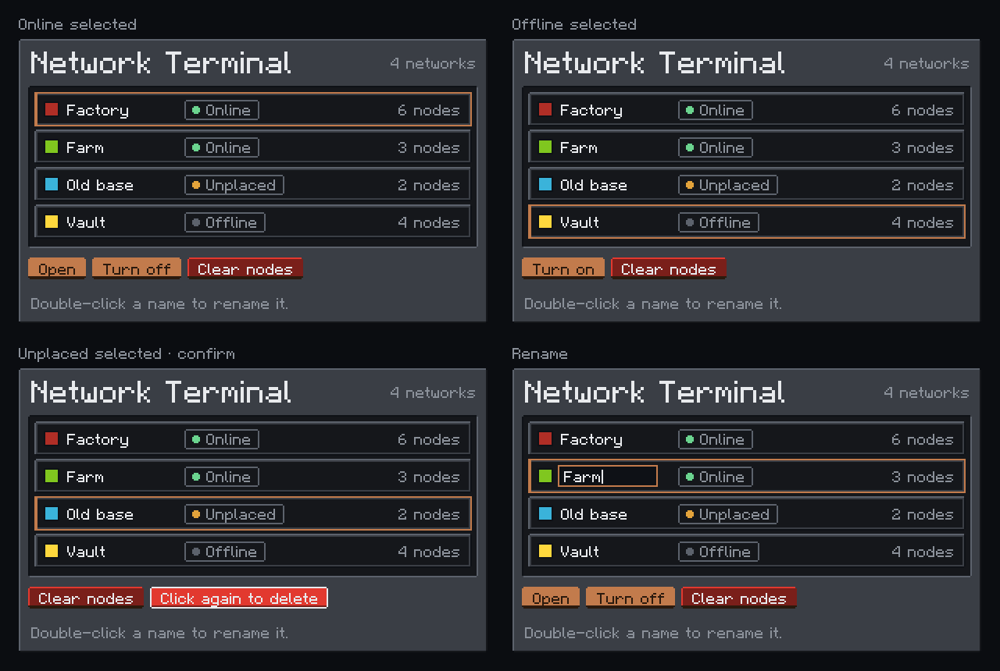

# Terminal de rede

O Network Terminal (`redweave:network_terminal`) é o bloco que administra todas as redes de um player. Esta página descreve o bloco na Fase 1, numa issue própria depois da Tela do Controlador (#20), antes da 0.1 (pergunta 151). A rede está em [`rede-e-canais.md`](rede-e-canais.md), e o Network Controller, onde cada rede nasce, em [`controlador-de-rede.md`](controlador-de-rede.md). Os termos são os do [`glossario.md`](../glossario.md).

## Em uma frase

Um clique com a mão vazia no Terminal mostra todas as redes do dono, de onde ele as renomeia, desliga, religa, limpa e abre.

## O que o Terminal não faz

Não cria redes. A rede nasce ao colocar um Network Controller, e cada controlador é uma rede (perguntas 129 e 130).

## Colocar e quebrar

| Ponto | Como é | Pergunta |
|---|---|---|
| Dono | Quem colocou o bloco. Só ele usa o Terminal | 134 |
| Quantidade | Um por player no servidor. Colocar um segundo é recusado, e a action bar mostra `You already have a Network Terminal at <x>, <y>, <z>.` Se o Terminal registrado sumiu sem ser quebrado e o chunk dele está carregado, o registro cai e o novo entra; com o chunk descarregado, recusa (regra 6) | 137, 253 e 254 |
| Quebrar | Só o dono, no survival. Explosões não o destroem. No criativo, quebra, como o Network Controller (pergunta 30) | 137 |
| Chave do Configurator | Não retira o Terminal | 164 |
| Registro | O servidor guarda o Terminal de cada player no save das redes, numa lista `terminals` com `player` e o bloco, e a BlockEntity guarda o dono com a chave de NBT `owner`, para o limite valer também com o chunk descarregado | 175 |

## Clicar

| Quem clica | O que acontece | Pergunta |
|---|---|---|
| O dono, com a mão vazia | Abre a tela do Terminal | 130 |
| Outro player | Nada abre, e a action bar mostra `Only the owner can use this terminal.` | 153 |

O Terminal alcança todas as redes do dono, em qualquer dimensão e a qualquer distância, porque lê o save das redes, sem carregar chunk (regra 6 e pergunta 152). O servidor confere o dono e a distância de interação com o bloco em cada ação (regras 16 e 17).

## Tela

O desenho tem quatro variantes, e os sprites novos estão em [`tela-do-terminal-sprites.png`](../imagens/telas/tela-do-terminal-sprites.png): a linha selecionada e os botões de perigo, de hover e de confirmação. O resto reaproveita os sprites da Tela do Nó.

Uma lista das redes do dono, em ordem alfabética pelo nome, com o estado de cada uma ao lado e a quantidade de nós (perguntas 131 e 138).

Um clique seleciona uma rede, e a barra de botões embaixo da lista mostra só as ações que valem para o estado dela. Limpar nós e `Delete` confirmam no segundo clique, no próprio botão, e o duplo clique no nome renomeia, como na Tela do Controlador (perguntas 222 e 252).

O topo mostra a contagem, como `1 network` ou `4 networks` (pergunta 261), e a dica `Double-click a name to rename it.` fica no rodapé. Os botões são `Open`, `Turn off`, `Turn on`, `Clear nodes` e `Delete`, e a confirmação mostra `Click again to clear` ou `Click again to delete` (pergunta 255). Sem nenhuma rede, a lista mostra `No network yet. Place a Network Controller to create one.` (pergunta 256).

| Ação | Em quais redes | O que faz | Pergunta |
|---|---|---|---|
| Abrir | `Online` | Abre a tela do Network Controller da rede, a qualquer distância e em qualquer dimensão. Ela fica ancorada no Terminal: vale enquanto o dono está ao alcance dele e a rede segue `Online`, e o Esc fecha tudo | 131, 158, 259 e 260 |
| Renomear | Todas | Troca o nome, com o limite de `network.name_length` | 156, 158 e 176 |
| `Offline` | `Online` | Desliga a rede | 132 |
| `Online` | `Offline` | Religa a rede | 132 e 135 |
| Limpar nós | Todas | Tira todos os nós da rede, que perdem os slots e ficam `No network` no mundo. Pede confirmação no segundo clique, como o `Clear log` da Tela do Controlador | 133 |
| `Delete` | `Unplaced` | Apaga a rede de vez, com confirmação. Os nós dela ficam `No network` | 166 |

Uma rede `Offline` aparece só como a linha da lista: a tela do controlador dela não abre, nem pelo Terminal (pergunta 158). Uma rede `Unplaced` não pode ser religada até o controlador voltar ao mundo (pergunta 135).

## Estados que o Terminal controla

| Estado | Quando | Efeito | Pergunta |
|---|---|---|---|
| `Online` | Controlador no mundo e rede ligada | A rede funciona | 135 |
| `Offline` | Desligada no Terminal | Todos os canais valem 0. O controlador e os nós dela não aceitam interação do player, e o Configurator não abre, não copia, não cola e não alterna neles. O dono ainda quebra os blocos, e a Chave funciona | 132, 136, 163 e 241 |
| `Unplaced` | O controlador saiu do mundo | Todos os canais valem 0. Só sai pelo controlador recolocado ou pelo `Delete` | 135, 146 e 166 |

## Item

| Parte | O que é |
|---|---|
| ID | `redweave:network_terminal`, o mesmo do bloco. É contrato e fica fixado na #26 (pergunta 155) |
| Nome | `Network Terminal`, e `Terminal de Rede` em português |
| Aba do criativo | `Redweave` (pergunta 69) |

## Pendências

| Ponto | Depende de |
|---|---|
| A receita | Issue #24 |

## Histórico de modificações

| Pessoa | Data e hora | Modificação |
|---|---|---|
| Zennd | 2026-11-12 17:18 | Aponta a confirmação para o `Clear log` e inclui o `Toggle` na rede `Offline` (pergunta 241). |
| Zennd | 2026-11-12 09:49 | Aplica as perguntas 251 a 256: o conceito do bloco, a barra de ações, os textos e o Terminal perdido; adiciona o desenho da tela. |
| Zennd | 2026-11-11 10:24 | Aplica as perguntas 175 e 176. |
| Zennd | 2026-11-11 09:51 | Cria o documento, com as respostas das perguntas 129 a 166. |
